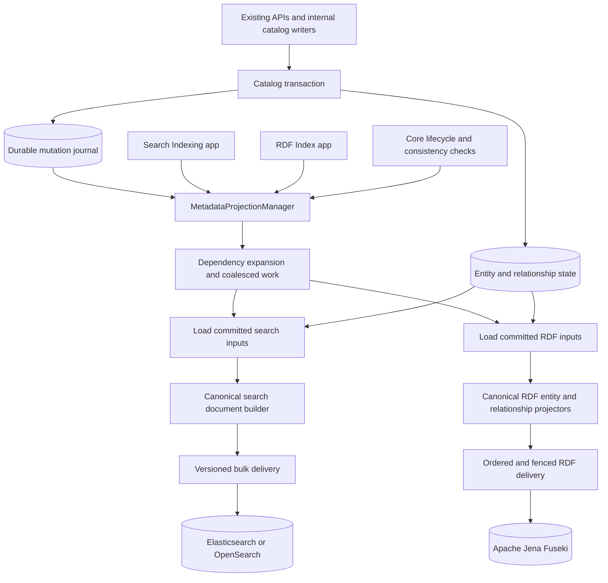

# Reliable database-to-search and RDF projection

Status: accepted direction; implemented for 2.2 by the stacked PRs #35570–#35577, merged in
order. Baseline code examined at `9d5f2d3f77c`.
Implementation steps and measured verification are tracked in the
[implementation plan](2026-10-06-database-projection-implementation.md). The end-to-end durability
and performance guarantees below remain release gates, not claims about the current implementation.

## Recommendation and compatibility boundary

Make search and the Apache Jena/Fuseki knowledge graph continuously maintained projections of
committed catalog state. Persist mutation facts in the same database transaction as each relevant
change, with durable obligations for each enabled projection. Feed live updates, retries, repairs
and rebuilds through a common runtime with separate search-document and RDF-graph projectors.
Run managed workers inside OpenMetadata by default; allow the same runtime to run in a separate
worker process for resource isolation. Neither deployment requires ingestion clients, SDKs or
users to manage indexing or install a message broker.

The selected migration is to **centralize execution now, keep the indexing apps working, and
deprecate them later**. A proposed concrete `MetadataProjectionManager` owns capture consumption,
delivery, initial population, recovery, reconciliation and generation changes for search and
enabled RDF support. The Search Indexing app remains an administrative adapter with its existing
manual run, configuration, status, history and cancellation experience. `RdfIndexApp` delegates to
the same manager for RDF maintenance. Neither app owns a second indexing implementation.

Remove routine recurring indexing schedules after the reliability gates pass; normal mutations
and recovery run continuously through the manager. Manual maintenance remains available through
the apps. App/UI removal and endpoint deprecation are later work, not prerequisites for this
change. Existing API/SDK callers do not acquire indexing responsibilities.

Keep Elasticsearch/OpenSearch for this work. Engine replacement is a separate decision and is not
required to establish automatic, reliable indexing. New and existing API/ingestion callers keep
writing catalog data through their current APIs without learning an indexing protocol.

The core guarantee is: **if a catalog mutation commits, the obligation to update every affected
search document and RDF projection unit survives a process crash.** Search or Fuseki unavailability
creates an independently recoverable backlog. Success in one target cannot acknowledge the other.
This is eventual convergence of enabled projections, not an atomic transaction across SQL, search
and Jena. Callers keep using the existing catalog API; RDF remains optional by deployment config.

There is one compatibility decision that cannot be hidden behind unchanged REST schemas. The
live lifecycle handler is synchronous and some primary-document operations wait for search
visibility, but child propagation already submits asynchronous search tasks. There is no blanket
read-your-write guarantee for an entire dependency cascade. Moving primary-document delivery to
background workers can still change observable behavior, so inventory consistency per operation.
We cannot promise immediate search visibility, no search-dependent request latency, and continued
writes during a search outage at the same time. Current error handling also weakens visibility
during failures.

Adopt the durability and unified projection design while retaining the existing synchronous wait
policy first. The recommended eventual destination is asynchronous writes with a measured search
freshness SLO, provisionally p99 within two seconds for ordinary changes under healthy, provisioned
load. That number is a benchmark target, not a hard guarantee or an approved contract change.
Keep the asynchronous cutover conditional on accepting that consistency behavior. Entity reads
from the authoritative database remain immediate; search-backed endpoints require their own audit.

## What the current code establishes

| Finding | Evidence | Design consequence |
|---|---|---|
| The lifecycle handler is synchronous; completion of all dependent documents is not. | [`SearchIndexHandler.isAsync()`](../../openmetadata-service/src/main/java/org/openmetadata/service/events/lifecycle/handlers/SearchIndexHandler.java) returns false explicitly to preserve read-your-write. [`RepositorySideEffectScope`](../../openmetadata-service/src/main/java/org/openmetadata/service/jdbi3/RepositorySideEffectScope.java), extracted from `EntityRepository`, drains search and lineage callbacks synchronously after commit. Child propagation can submit background search tasks from those callbacks. | Simply putting the handler on an executor changes some existing behavior and does not establish durability. Pin visibility expectations per operation. |
| Live updates do more than build documents. | [`SearchRepository.updateEntityIndex()`](../../openmetadata-service/src/main/java/org/openmetadata/service/search/SearchRepository.java) chooses scripted partial updates or full builds, synchronizes columns, and propagates changes. [`ElasticSearchEntityManager`](../../openmetadata-service/src/main/java/org/openmetadata/service/search/elasticsearch/ElasticSearchEntityManager.java) and its OpenSearch twin use `refresh=true` for every write. | Document content, propagation, delivery, and visibility policies need separate ownership. |
| No search write is ordered. | No write uses external versioning or `if_seq_no`; writes are scripted upserts with `retryOnConflict(3)`. Only the `relationshipRevision` script guard (test cases, logical suites) rejects older state. Since 2026-10-10, live entity writes and in-place rebuild writes skip a document read more recently ([Rebuilds today](#rebuilds-today-in-place-by-default-implemented-2026-10-10)); other writes are still unordered. | The version fence in delivery is new machinery, not an extension of an existing one. |
| Rebuild and live paths already share useful building blocks. | [`SearchIndex`](../../openmetadata-service/src/main/java/org/openmetadata/service/search/indexes/SearchIndex.java), [`SearchIndexFactory`](../../openmetadata-service/src/main/java/org/openmetadata/service/search/SearchIndexFactory.java), and [`ReindexingUtil.populateDocBuildContext()`](../../openmetadata-service/src/main/java/org/openmetadata/service/workflows/searchIndex/ReindexingUtil.java) share field selection and enrichment. [`ElasticSearchBulkSink`](../../openmetadata-service/src/main/java/org/openmetadata/service/apps/bundles/searchIndex/ElasticSearchBulkSink.java) builds documents and emits bulk writes. | Extend these components; the problem is not two wholly independent sets of document builders. |
| The existing durable queue captures failures, not every committed mutation. | [`SearchIndexRetryQueue.enqueue()`](../../openmetadata-service/src/main/java/org/openmetadata/service/search/SearchIndexRetryQueue.java) is mostly called after failures, through the global DAO rather than the caller's transaction, and logs if its own insertion fails. Some callers use it as the normal path ([`DataProductRepository.reindexAfterDomainDetach()`](../../openmetadata-service/src/main/java/org/openmetadata/service/jdbi3/DataProductRepository.java) outside a deferral scope; `SearchRepository` when the client is unavailable). Entity-manager-level enqueues pass no FQN or entity type, so with the `(entityId, entityFqn)` key one entity can hold two rows, one without propagation context. | A crash after catalog commit but before indexing or retry insertion can leave no recoverable intent. |
| Retry recovery is valuable but has limits. | [`SearchIndexRetryWorker`](../../openmetadata-service/src/main/java/org/openmetadata/service/search/SearchIndexRetryWorker.java) has claimed work, stale-claim recovery, bulk rebuilding, a three-attempt ceiling, and a cascade capped at 5,000 entities without a persisted continuation for the remainder. | Reuse the recovery concepts, but make unfinished work durable and distinguish transient outages from invalid documents. |
| Accepted propagation tasks do not establish completed propagation. | The single-field `submitChildUpdate()` paths in [`ElasticSearchEntityManager`](../../openmetadata-service/src/main/java/org/openmetadata/service/search/elasticsearch/ElasticSearchEntityManager.java) and [`OpenSearchEntityManager`](../../openmetadata-service/src/main/java/org/openmetadata/service/search/opensearch/OpenSearchEntityManager.java) call `updateByQuery` with `waitForCompletion(false)` and `conflicts=proceed`, discarding the returned response in the inspected methods. | Track durable affected-document deliveries; task acceptance is not a completion acknowledgment. Any retained bulk-task optimization needs task outcome and skipped/conflicted-document accounting. |
| Some indexing already runs with the server, while rebuild execution and reporting retain app dependencies. | [`OpenMetadataApplication`](../../openmetadata-service/src/main/java/org/openmetadata/service/OpenMetadataApplication.java) registers the retry worker and distributed participant as managed services. [`SearchIndexApp`](../../openmetadata-service/src/main/java/org/openmetadata/service/apps/bundles/searchIndex/SearchIndexApp.java) invokes the orchestrator through a Quartz context; [`DistributedJobParticipant`](../../openmetadata-service/src/main/java/org/openmetadata/service/apps/bundles/searchIndex/distributed/DistributedJobParticipant.java) resolves an app run for progress; [`JobRecoveryManager`](../../openmetadata-service/src/main/java/org/openmetadata/service/apps/bundles/searchIndex/distributed/JobRecoveryManager.java) updates app run records. | Reuse the managed lifecycle, but move authoritative configuration, job state and recovery into the core service. Removing the app UI alone is insufficient. |
| The existing change-event stream is not a transactional capture boundary. | [`ChangeEventHandler.process()`](../../openmetadata-service/src/main/java/org/openmetadata/service/events/ChangeEventHandler.java) extracts events from 2xx HTTP responses, excludes some entity types, inserts afterward on a ForkJoinPool via [`EventFilter`](../../openmetadata-service/src/main/java/org/openmetadata/service/events/EventFilter.java), and catches insertion failures. | Tailing `change_event` as it exists cannot guarantee completeness or cover all internal writes. Keep its public contract separate. |
| Indexing extends beyond entity CRUD. | [`EntityTimeSeriesRepository`](../../openmetadata-service/src/main/java/org/openmetadata/service/jdbi3/EntityTimeSeriesRepository.java) has its own search hooks; [`LineageRepository`](../../openmetadata-service/src/main/java/org/openmetadata/service/jdbi3/LineageRepository.java), [`TagRepository`](../../openmetadata-service/src/main/java/org/openmetadata/service/jdbi3/TagRepository.java), and [`TableRepository`](../../openmetadata-service/src/main/java/org/openmetadata/service/jdbi3/TableRepository.java) also invoke search operations. Time-series search writes bypass the deferral scope; lineage writes autocommit and index inline, because the repository's JDBI `@Transaction` annotations are inert, as on `EntityRepository`. | Capture relationship, tag, extension, lineage, and time-series mutations as well as entity rows. Many of them have no transaction to join (section 1). |
| Live writes on other pods can be omitted from the promoted index. | [`DefaultRecreateHandler`](../../openmetadata-service/src/main/java/org/openmetadata/service/search/DefaultRecreateHandler.java) registered the staged target only in its own JVM's routing map. Distributed bulk workers receive their own target context, which does not populate live request routing on other pods. Since 2026-10-10 most runs rewrite the live index in place, and new-index runs share their routes through the database ([Rebuilds today](#rebuilds-today-in-place-by-default-implemented-2026-10-10)). | Persist generation membership and delivery obligations across the cluster; routing notifications alone cannot guarantee capture. |
| A failed rebuild can still replace the serving index. | [`DefaultRecreateHandler`](../../openmetadata-service/src/main/java/org/openmetadata/service/search/DefaultRecreateHandler.java) promotes any staged index whose document count is non-zero or unknown ("always-promote"), including after a failed run. Since 2026-10-10 this applies only to runs that need a new index; an in-place run has nothing to promote. | Prove coverage and catch-up before automatic promotion. Row counts alone cannot establish correctness. |
| RDF already has a durable ordered delivery queue, but capture is separate from catalog commit. | [`RdfUpdater.submit()`](../../openmetadata-service/src/main/java/org/openmetadata/service/rdf/RdfUpdater.java) uses `PostCommitActionQueue.runOrDefer`; [`RdfLiveWriter.enqueue()`](../../openmetadata-service/src/main/java/org/openmetadata/service/rdf/RdfLiveWriter.java) reaches [`RdfLiveWriteStore.enqueue()`](../../openmetadata-service/src/main/java/org/openmetadata/service/rdf/RdfLiveWriteStore.java), which opens its own SQL transaction. | Reuse delivery machinery, but move the recoverable obligation into the catalog transaction. A durable queue after a callback still leaves a crash gap on deferred paths. |
| RDF delivery, graph ownership and rebuild coordination already have useful safeguards. | `RdfLiveWriteStore` serializes queue insertion and cluster-wide draining, retains exhausted writes, and records health. [`RdfDatasetManager`](../../openmetadata-service/src/main/java/org/openmetadata/service/rdf/rebuild/RdfDatasetManager.java) and [`RdfRebuildStore`](../../openmetadata-service/src/main/java/org/openmetadata/service/rdf/rebuild/RdfRebuildStore.java) use a durable serving pointer, mutation replay and build fences. [`JenaFusekiStorage`](../../openmetadata-service/src/main/java/org/openmetadata/service/rdf/storage/JenaFusekiStorage.java) scopes entity replacement by predicate ownership. | Adapt these components to the common capture/delivery contract; do not replace them with untracked asynchronous callbacks or a generic whole-subject overwrite. |
| RDF status and rebuild policy retain app dependencies. | [`RdfProjectionStateResolver`](../../openmetadata-service/src/main/java/org/openmetadata/service/rdf/RdfProjectionStateResolver.java) derives state from the latest `RdfIndexApp` run. [`RdfIndexApp`](../../openmetadata-service/src/main/java/org/openmetadata/service/apps/bundles/rdf/RdfIndexApp.java) has a configurable promotion success ratio, defaulting to 0.95. | Derive health from actual core projection progress and unresolved work. Automatic RDF promotion needs complete coverage and catch-up, not a successful app run or ratio alone. |

These are source observations and failure modes, not a diagnosis of a particular production incident.
The [entity repository epic](2026-09-17-entity-repository-epic.md) already proposes a unit of work and
outbox under its pain 5. This design should share that transaction boundary rather than establish a
competing framework.

The multi-replica routing failure has a concrete sequence:

1. Pod A starts a rebuild and registers its staged target locally.
2. The rebuild reads entity E and writes its current state into the staged index.
3. A request on pod B changes E. Its local routing map has no staged target, so its successful
   live search write reaches the old serving index only.
4. Promotion switches the aliases to the staged index, which still contains E's earlier state.

The catalog mutation remains in the database, but its search update is absent after promotion.
No search exception occurred, so the failure-only retry queue cannot repair this case. The timing
qualification matters: a mutation read by the subsequent scan may be included. Distributed
[`PartitionWorker`](../../openmetadata-service/src/main/java/org/openmetadata/service/apps/bundles/searchIndex/distributed/PartitionWorker.java)
passes a staged target to its bulk sink; that does not close the live-routing gap. This failure
mode is verified from source and reviewer feedback; an executable two-pod reproduction remains
a required validation step.

## Approaches considered

| Approach | Benefit | Cost / limitation | Main code areas | Risk |
|---|---|---|---|---|
| A. Unified projector, synchronous visibility, transactional recovery | Preserves current healthy-path visibility while closing the lost-intent gap and removing divergent indexing behavior. | Search execution and visibility still affect write latency. | Repository/DAO transaction boundary, lifecycle handler, search builders and clients, retry worker. | Medium; preferred migration starting point. |
| B. Transactional outbox and managed asynchronous projection workers | Durable automatic recovery, batching, coalescing, resource controls, and no search/Fuseki network call in ordinary write requests. Uses the existing DB, search engine and configured RDF store. | Additional transactional DB cost, including required removal context; bounded freshness is an SLO, not immediate visibility. Embedded workers still compete for resources. | A's foundation plus independent target delivery/generation state, canonical RDF projection, core service lifecycle, maintenance orchestration and legacy app adapters. | High during consistency and writer cutover; recommended target after validation. |
| C. Database-log CDC feeding the same projector | Captures changes outside repository code and can move capture/processing outside API processes. | Requires replication configuration, privileges, offset/log retention and failover management; row changes still need OpenMetadata's relationship and document semantics. | CDC integration and runtime packaging plus the same projection, delivery, and rebuild components as B. | High operational and compatibility scope; optional future adapter. |

A and B use the same implementation; the difference is whether a request waits for its required
projection revision to become visible. Do not retain two implementations to support those policies.

CDC does not inherently require Kafka: Debezium can be embedded. It still needs durable offsets
and duplicate handling, so avoiding a broker does not eliminate capture lifecycle work.
[Debezium Engine documentation](https://debezium.io/documentation/reference/stable/development/engine.html).
PostgreSQL replication slots also introduce log-retention and replay responsibilities.
[PostgreSQL logical decoding](https://www.postgresql.org/docs/15/logicaldecoding-explanation.html).

Database triggers writing compact outbox records are another capture implementation, not a
replacement for projection logic. Defer them unless arbitrary SQL writes must be captured: they
add two-dialect migration and bulk-write complexity. Initially, supported application writes and
migrations must use the shared capture boundary or explicitly register reconciliation work.

**A mandatory Redis durable queue (streams or lists) was evaluated and rejected.** Making Redis
mandatory does not solve the problem this design addresses:

- **No atomicity with the catalog commit.** A Redis write cannot join a MySQL or Postgres
  transaction. Writing after commit reproduces today's crash gap. Writing before commit publishes
  uncommitted state. The database outbox would still be required, and Redis would add a hop after
  it without adding durability.
- **Weaker durability than the catalog DB.** AOF `everysec` can lose about a second of
  acknowledged writes, replication is asynchronous, failover can drop acknowledged entries, and
  common `maxmemory` eviction policies discard keys under pressure. Each of these silently loses
  obligations.
- **Opposite failure semantics to today's Redis use.** Redis is an optional L2 cache
  (`cache.provider` defaults to `none`). Its circuit breaker deliberately skips writes while Redis
  is unhealthy, which is correct for a cache and wrong for a queue that must never drop work.
  Sharing one instance would put queue entries under cache eviction and TTL policy.
- **The queue is not the bottleneck.** Catalog mutation rates are low for a database queue.
  Throughput is bounded by DB hydration, search bulk writes and the single Fuseki/TDB2 writer.
- **Operational cost.** Every quickstart and small deployment would gain a mandatory stateful
  dependency.

When Redis is configured, it may carry a lossy "work available" hint on the existing
[`CacheInvalidationPubSub`](../../openmetadata-service/src/main/java/org/openmetadata/service/cache/CacheInvalidationPubSub.java)
channel, so workers wake without waiting for the next poll. Correctness never depends on it: the
DB poll remains the backstop. If DB queue throughput ever becomes the limit, the scale-out route
is approach C, not a second durable store.

## Proposed architecture



### 1. Capture mutations at the persistence boundary

The transaction-scoped `CollectionDAO` used for each mutation must also perform its journal insert.
A separate JDBI handle, response filter, post-commit callback, or in-memory queue is not equivalent.
Rollback and deadlock retries must roll back capture with the mutation. If durable capture fails,
the catalog transaction must fail rather than acknowledge an untracked change.

**Transaction coverage is still a feasibility gate.** Both repository entry paths now delegate to
[`RepositoryTransactionRunner`](../../openmetadata-service/src/main/java/org/openmetadata/service/jdbi3/RepositoryTransactionRunner.java),
which exposes the retained root's active transaction through
[`RepositoryTransactionContext`](../../openmetadata-service/src/main/java/org/openmetadata/service/jdbi3/RepositoryTransactionContext.java),
and shares one retry and post-commit boundary. This does not prove that every catalog write enters
that boundary. Fault-injection tests on both database dialects must prove that mutation and journal
insertion commit or roll back together for every supported write family. Do not treat capture as one universally
applicable hook until that evidence exists.

The source review found two gaps in that coverage:

- **The original entry paths exposed different capture contexts.** The baseline flush opened on
  `Entity.getJdbi()` while explicit transactions used the retained DAO root. Despite the original
  javadoc's warning, the baseline handle-identity test and mixed-boundary PostgreSQL rollback tests
  passed; an independent-commit bug was not reproduced. The confirmed gap was that explicit
  transactions did not expose `RepositoryTransactionContext`. The shared runner fixes that gap;
  the consolidated tests cover both boundary forms and their nesting. Entity-row journal capture
  is now implemented separately in the DAO decorator described below; the other write families
  remain coverage gates.
- **Many search-relevant writes have no transaction at all.**
  - Soft delete: the child cascade and the parent commit separately.
  - `bulkUpdateEntities`, follow and vote, and `patchChangeSummary`.
  - Bulk asset operations for domains, data products, ports, and tags or glossary terms on assets.
  - Team membership, query usage, knowledge-page usage and `TableRepository.addDataModel`.
  - Lineage add and delete.
  - Every `EntityTimeSeriesRepository` write. Its follow-on test-case status update is a separate
    transaction.
  - Usage, sample data, profiles, profiler config, custom metrics and joins.
  - Pipeline status: a raw batch on its own handle.
  - `DataRetention` raw deletes and its `DataRetentionExtension` SPI.
  - Migrations.

Hook capture at the search-relevant write interfaces with a JDBI handler decorator, not at repository
methods. The interfaces are `EntityDAO`, `EntityRelationshipDAO`, `FieldRelationshipDAO`,
`EntityExtensionDAO`, `TagUsageDAO` and `EntityTimeSeriesDAO`. Callers are widespread: about 320
`relationshipDAO()` call sites alone. These interfaces are where the writes converge.

- Handle-attached DAOs (`MetricGroupRepository`, `ConversationRepository`) and raw batches
  (`PipelineRepository`) are named exceptions.
- Association prefix rewrites (`TagUsageDAO.rename`/`updateTagPrefix`, `renameByToFQNPrefix`)
  retain the affected association membership and both old/new locators: an association has no
  stable identity of its own, so its former membership cannot be rediscovered later.
  Capture must know the typed selection contract; parsing arbitrary SQL is not that contract.
- Entity prefix rewrites (`EntityDAO.updateFqn`) record **one prefix fact per table**, not one
  fact per descendant. See below.

`EntityDAO.updateFqn` accepts an internal `FqnPrefixRewrite` request through its inherited SQL
method. The public repository method remains `updateFqn(oldPrefix, newPrefix)`. On both
databases, the shared SQL assignment rewrites only the row's own `fullyQualifiedName`. The
container DAO selects nested rewriting, which also changes the FQNs its columns store. Values are
bound, and only the leading hash prefix changes.

Capture runs that single statement unchanged and buffers one `EntityPrefixMutation` (entity
type, old prefix, new prefix). Every row the statement changes is under the new prefix when the
transaction commits, so expansion enumerates the members from committed state with
[`EntityPrefixMembers`](../../openmetadata-service/src/main/java/org/openmetadata/service/projection/EntityPrefixMembers.java),
one keyset index range per page. Each member's former locator is derived from the fact. Rows that
were already under the new prefix are included; the set is a superset and expansion refreshes by
ID. The cases that seemed to need per-descendant facts are covered by other facts:

- A descendant deleted before expansion records its own `DELETE` fact by ID.
- A subtree renamed again records its own prefix fact, and a single entity rename records its own
  entity fact.
- Historical owner lookup resolves an old hash through the chain of prefix facts. A hop only
  applies rewrites allocated after the one that produced it: a rewrite that moved a subtree waited
  for the earlier rewrite's commit before inserting its own fact.

Recording a fact per descendant made a 10,000-descendant rename issue 321 statements and take
roughly four times the uncaptured time; the prefix fact adds two statements to the rename
(evidence in the [implementation notes](2026-10-06-database-projection-implementation.md)).
Prefix facts are retained like rename anchors, since they are the only record of the former names.

The journal may contain a superset of affected keys: projection from committed state can tolerate
redundant invalidations. A **write-ahead intent** was considered for autocommit paths: persist
`PENDING_COMMIT`, perform the mutation, then mark the intent ready. Age alone cannot safely release
and retire an unfinished intent. A sweeper could project the old state while a slow producer is
still running; that producer could then commit and die before marking the intent ready.

Prefer enclosing each supported mutation and capture in a real transaction, including bounded
bulk chunks. Any interim write-ahead protocol needs proof that the source operation has finished
or cannot commit later before recovery can settle its obligation, with retained removal context
and a slow-producer/crash test. Until then it is a coverage gap, not a substitute implementation
of `captureInTransaction`. A process timeout or stale heartbeat alone is not that proof.

The initial implementation of this boundary is
[`EntityMutationCapture`](../../openmetadata-service/src/main/java/org/openmetadata/service/projection/EntityMutationCapture.java),
registered explicitly on JDBI in integration tests. It decorates standard `EntityDAO` row writes,
uses the SQL object's supplied handle and wraps an autocommit call in `Handle.inTransaction`.
`ProjectionJournal` captures facts and independent target obligations there; batch calls preserve
one enclosing transaction across their SQL chunks. Registration during server startup remains
pending: the other persistence families, removed dependency membership, delivery adapters and
latency gates are not covered merely by this entity-row implementation.

Relationship capture now uses the same journal through
[`RelationshipMutationCapture`](../../openmetadata-service/src/main/java/org/openmetadata/service/projection/RelationshipMutationCapture.java).
`MutationFacts` distinguishes entity facts from relationship batches. A batch retains stable
endpoint/type pairs, relation and subtype, ontology relationship/type IDs, and old/new lineage
pipeline IDs in `metadata_projection_relationship`. Both consumers page the same immutable
membership; acknowledging search does not remove the RDF consumer's input. The unreleased `2.2.0`
schema contains the complete projection tables; no patch-release migrations or legacy backfill
are needed for this unshipped feature.

The capture adapter derives selections from the existing DAO's declared SQL and reuses its JDBI
parameter customizers. Inheritance, source filters and exclusion rules stay in the DAO. This is
a bounded set of supported SQL shapes, not a parser for arbitrary caller-supplied statements;
unknown declared update shapes fail during SQL-object construction. Raw SQL and overridden DAO
methods remain explicit coverage gaps.

Destructive relationship operations lock and retain membership, then delete/repoint only those
primary keys through a retained-key SQL join. This makes membership selection the operation's linearization
point and prevents a later concurrent insert from being changed without capture. Inserts from
catalog/parent selections materialize their candidate set in SQL and insert from that set.

Point writes name their own rows: relationship `insert`/`insertOntologyRelationship`/`bulkInsertTo`
and tag `applyTag`/batch application. Their capture runs the source statement unchanged and buffers
the membership row taken from the call's arguments. At commit, the buffer writes one header per
membership kind, every buffered snapshot row and the consumer obligations in a few multi-row
statements for the whole transaction. A point write therefore needs no guard insert, header insert,
snapshot read or savepoint of its own. The exception is a MySQL upsert resolved through a secondary
unique key (metric-group membership or an ontology relationship ID), which can update a different
row. That case reads the row back once after the statement and retains it as well. PostgreSQL
rejects those conflicts.

`CaptureTransaction` wraps standalone calls and protects compound capture, such as a retained
delete, with a savepoint inside an existing transaction. Point writes skip the savepoint: a failed
statement has buffered nothing. A failed buffer flush instead poisons the transaction, so it cannot
commit after a caller catches the error. A lost savepoint aborts the transaction without closing
the caller's connection, and a failed rollback during commit leaves the connection to the pool, so
the transaction owner receives the original error, such as a deadlock, and retries the whole unit.

Tag association capture now uses
[`TagUsageMutationCapture`](../../openmetadata-service/src/main/java/org/openmetadata/service/projection/TagUsageMutationCapture.java)
and the same transaction/journal contract. The `2.2.0` schema retains source, tag FQN/hash and
target hash in `metadata_projection_tag_usage`. Captured writes include point/batch applications,
all current-schema deletion selectors, exact renames and prefix rewrites. Destructive operations
use retained-key SQL joins; consumers read immutable pages of at most 1,000. Renames retain
both old and new association locators. Tag prefix SQL is now declared with bound parameters in
`TagUsageDAO`, and its compound root/child rename is transactional. The legacy pre-1.1 hash
migration references a removed column and remains outside current-schema capture.

[`ProjectionOwnerLookup`](../../openmetadata-service/src/main/java/org/openmetadata/service/projection/ProjectionOwnerLookup.java)
resolves candidate IDs from the owning repository's declared catalog table and retained entity
mutation history. A source declaration specifies whether descendant hashes represent owned
fields; the lookup does not infer this from a fixed FQN depth. It uses the existing FQN hashing
rules, so quoted dots do not become hierarchy boundaries. Name reuse can return both historical
and current owners; each must be reconciled from committed state. An empty result is unresolved,
not permission to acknowledge an obligation.

The `2.2.0` schema indexes before/after entity hashes captured in the original journal insert.
Lookup combines current rows and retained history in one SQL statement, after first resolving
the hash through any later prefix facts. Compaction keeps a committed locator anchor for every
former identity/name pair: renames, deletes of named rows and prefix rewrites. An entity fact
that retires no locator (an insert, an unchanged-name update or a delete of a missing row) is
discarded once its consumers finish. The current row, or the later fact that changes it, resolves
that name, so anchors grow with renamed and deleted entities rather than every entity ever written.
Sweep cursors wrap so late commits are revisited. Repository ownership declarations, complete write
coverage, dependency expansion and delivery workers remain required before production registration
or schedule removal.

Deletion capture retains every explicitly requested entity ID, including IDs absent during the
preimage read. Under `READ COMMITTED`, another transaction can insert such a row and finish its
projection before the delete statement runs. Skipping the absent ID would then lose the committed
deletion. The two-database concurrent insert/delete test reproduces this interleaving.

Instrument common persistence primitives for entity rows, relationships, field relationships,
tag usage, extensions and indexed time-series records. Record compact facts: changed keys,
mutation kind, relevant relation endpoints, and before/after locators needed for removal or rename.
Group facts per transaction where possible. Do not construct search documents or enumerate a
large dependency tree on the request thread.

Normal application developers continue using repository operations. They do not call an indexing
API or decide whether to retry. Projection definitions declare fields and dependencies once when
an entity or search field is added. Tests and a restriction on direct search mutations make this
an enforced boundary rather than a convention to remember.

Bulk SQL, imports, recursive deletes, migration utilities, scheduled jobs, and extension code are
part of the coverage inventory. Before deleting rows or edges, capture the identifiers required
to remove their documents and repair surviving references. For large deletes, persist membership
alongside each committed deletion chunk; a root FQN alone is insufficient after the graph is gone.

### 2. Maintain one definition of each projection

Share capture, dependency infrastructure and lifecycle, while keeping target-specific projection
contracts. Search and RDF do not have identical fields, exclusion lists, ownership boundaries or
dependency fan-outs. RDF must load its own declared inputs through
[`RdfIndexingFields`](../../openmetadata-service/src/main/java/org/openmetadata/service/rdf/RdfIndexingFields.java),
not reuse search JSON or a narrower search field selection. Both projectors must use canonical
repository inheritance and relationship semantics, with bounded, coherent DB reads.

Evolve the existing index factory, required-field definitions and `DocBuildContext` into a common
loader and builder contract. Its inputs come from committed DB state, including inherited fields
and relationships. A rebuild supplies keys to this loader, not a separate interpretation of the
entity or a stale entity snapshot carried through a long queue.

Load each bounded group from a coherent database snapshot, including its revision marker. All
builder lookups must use that snapshot or verified revision-aware inputs; current helpers that
read unrelated caches or open independent reads need adaptation. Start with primary-DB reads.
Replica reads are safe only with a proven replay-position fence.

Prefer complete replacement of the owned document fields: removing an owner, tag or relationship
must actually remove it from search. Preserve public document fields, analyzers, IDs, aliases,
filters, ranking and deleted-entity semantics. Batch-prefetch dependencies to avoid N+1 reads.
Partial updates remain an optimization only where they demonstrably produce the same state and
obey the same revision checks.

An entity can own multiple documents. Table columns and time-series/composite IDs need explicit
document keys and an emitted-document manifest, so renamed or removed subdocuments are deleted.
Keeping the table's main document current does not prove its column index is current.
Column documents are keyed by `UUID.nameUUIDFromBytes(columnFQN)`. Column changes run a
delete-by-query on `table.id` and then reindex every column. This is safe today only because both
steps run synchronously with `refresh=true`. Asynchronous delivery needs per-table ordering, or a
manifest diff that deletes only the removed keys. Otherwise a late delete-by-query can erase newly
indexed columns.

Embeddings and other derived artifacts need explicit ownership too. Reuse only artifacts matching
the current input fingerprint and model version; preserve or regenerate them through the shared
delivery layer. Late embedding results must be conditionally applied against that fingerprint and
target generation. Keyword indexing must not wait on an embedding provider. Reusing the existing
embedding support requires parity tests; blindly replacing `_source` would lose those fields.
Today [`OpenSearchVectorService`](../../openmetadata-service/src/main/java/org/openmetadata/service/search/vector/OpenSearchVectorService.java)
merges the embedding fields into the main document with a partial update. Chunks go to
`data_asset_embeddings_chunks`, which is a second owned document set per entity.

### 3. Treat dependency changes as durable work

| Mutation | Examples of projections to invalidate |
|---|---|
| Entity fields | The entity and any documents embedding those fields. |
| Owner/team, service, domain or data-product changes | Referencing entities and applicable inherited descendants. |
| Tags, glossary terms, classification rename/deletion | Tagged entities, tagged columns, and dependent inherited classifications. |
| Relationship or lineage insertion/removal | Both relevant endpoints and documents embedding the affected relationship. |
| Table columns, test results, pipeline status, usage or extensions | Owning entity projection plus relevant child or time-series projections. |
| Index configuration or projection-definition change | Affected entity types/generations, even without a catalog entity-version change. |

Resolve dependencies from the database and retained deletion/rename context, not from the search
index being repaired. Include both old and new dependency sets: looking only at the graph after
an edge was removed misses documents that must lose the old value.

Fan-out uses paginated, durable tasks. Commit each page's child invalidations together with the
continuation cursor. A batch limit controls work per turn; it never declares the remaining work
complete. Concurrent graph changes produce their own captured invalidations. A source mutation
is settled only when expansion and the required child deliveries are accounted for.

#### Audited glossary and domain dependencies

The current live path contains substantial domain behavior, not just transport to a search engine.
The following source audit covers the paths raised during design review; it is not an exhaustive
inventory of every entity/extension and has not been validated against a running cluster.

| Change | Current source path | Behavior the core service must preserve |
|---|---|---|
| Glossary term hard deletion | [`GlossaryTermRepository.postDelete()`](../../openmetadata-service/src/main/java/org/openmetadata/service/jdbi3/GlossaryTermRepository.java) deletes term tag-usage rows. [`SearchRepository.deleteOrUpdateChildren()`](../../openmetadata-service/src/main/java/org/openmetadata/service/search/SearchRepository.java) removes the term from matching documents; [`REMOVE_TAGS_CHILDREN_SCRIPT`](../../openmetadata-service/src/main/java/org/openmetadata/service/search/SearchClient.java) also recomputes separated tag fields. | Remove the term document and references in affected assets/columns, including `tags` and `glossaryTags`; recompute other derived fields consistently with the canonical DB view. Preserve target membership before cleanup destroys it. |
| Glossary/term rename, move or tag change | `GlossaryTermRepository.updateAssetIndexes()`, `SearchRepository.propagateGlossaryTags()` and `propagateToRelatedEntities()` update referring assets using old/new FQNs or the term's tag FQN. | Update all affected term descendants and asset references, including classification tags derived from a term. Preserve old locators and recompute merged labels rather than blindly removing a label still justified by another source. |
| Asset domain assignment or removal | [`DomainRepository.bulkAssetsOperation()`](../../openmetadata-service/src/main/java/org/openmetadata/service/jdbi3/DomainRepository.java) changes relationships, invalidates cached views, and calls `updateEntityAndPropagateInheritedDomainsToChildren()`. | Recompute the asset's effective domains; removal may reveal an ancestor's domain. Update inheriting descendants and relevant columns/queries while retaining explicit overrides. |
| Data-product domain change | [`DataProductRepository.updateDataProductDomains()`](../../openmetadata-service/src/main/java/org/openmetadata/service/jdbi3/DataProductRepository.java) migrates linked assets and input/output ports, updates their search domains, propagates inheritance, and can detach conflicting data-product memberships. | Capture the resulting business-data mutations and refresh the product, assets, ports and inheriting descendants. Conflict cleanup remains a repository responsibility under its existing rule setting. |
| Domain rename | `DomainRepository.updateName()` rewrites domain/data-product FQNs; `updateSearchIndexes()` refreshes the root and rewrites descendant domain and embedded asset-domain references. | Refresh all affected identities and embedded references using stable IDs plus old/new locators. A parent-row-only event does not describe every changed projection. |
| Domain deletion | `DomainRepository.prepareChildrenForHardDeleteCascade()` retains data products with surviving domains and detaches deleted domains. `SearchRepository.deleteOrUpdateChildren()` removes asset references by `domains.id`. | Preserve surviving shared data products and domains; capture referencing assets before relationship cleanup. Recreating a same-named domain must not revive associations to the deleted ID. |
| Domain change on a table or its ancestry | `SearchRepository.reindexQueriesForDomainSource()` uses [`QueryRepository.forEachQueryBatchForDomainSource()`](../../openmetadata-service/src/main/java/org/openmetadata/service/jdbi3/QueryRepository.java). [`QueryDomainInheritance`](../../openmetadata-service/src/main/java/org/openmetadata/service/jdbi3/QueryDomainInheritance.java) derives query domains from referenced tables unless the query has explicit domains. | Invalidate affected queries even when their own stored JSON/version did not change. Reload the full set of table-domain inputs, deduplicate inherited domains and preserve explicit query domains. |
| Other inherited/embedded fields | [`EntityRepository.getSearchPropagationDescriptors()`](../../openmetadata-service/src/main/java/org/openmetadata/service/jdbi3/EntityRepository.java) and repository overrides describe owners, domains, reviewers, tags and nested fields; `SearchRepository` also has certification and service-style handlers. | Inventory these handlers and reuse their canonical field semantics. Domain fallback, owner inheritance and tag merging are different rules and must not become one generic recursive assignment. |

Extend the existing [`PropagationDescriptor`](../../openmetadata-service/src/main/java/org/openmetadata/service/search/PropagationDescriptor.java)
and required-field contracts with explicit dependency selection where appropriate. A declaration
needs the changed inputs, how to find affected projection keys, what pre-removal context to retain,
and when expansion is complete. Existing descriptors alone do not cover tag-usage reverse lookups,
query usage, column documents or every specialized repository route. Existing business mutations
and inheritance rules stay in their owning repositories/shared resolvers; the new service decides
what must be rebuilt and delivers it reliably. Normal writers must not remember to invoke handlers.

For a glossary term deletion, the durable sequence is:

1. Before deleting usage rows, retain their affected target locators in the same physical
   transaction as the deletion. [`ClassificationTagDAOs.TagUsageDAO`](../../openmetadata-service/src/main/java/org/openmetadata/service/jdbi3/ClassificationTagDAOs.java)
   currently stores `targetFQNHash`; it is not a universally available entity ID/type. Define and
   test how those locators resolve to stable owning entities and column paths, including concurrent
   renames/deletes. Retain any required lookup context before it can disappear.
2. Commit deletion, retained membership and the expansion obligation together. A set-based
   capture of affected rows can avoid building documents on the request thread, but it still costs
   O(affected rows) database work. If that exceeds the latency budget, retaining relationship history
   for later expansion is an alternative requiring an explicit storage/transaction design. A single
   root-ID event followed by querying already-deleted usage rows is not a valid shortcut.
   The retained set must cover the rows **actually deleted**: a preimage query followed by an
   unrestricted predicate delete can miss concurrent inserts at `READ COMMITTED`. Use an atomic
   delete/return-and-capture statement where supported, or delete the exact retained keys under
   locks in bounded pages. A preimage row lock alone does not lock absent rows on both databases.
3. Resolve and invalidate the owning entity projections in durable pages. Column-only usage also
   invalidates the table document: [`TableIndex`](../../openmetadata-service/src/main/java/org/openmetadata/service/search/indexes/TableIndex.java)
   merges column tags into table search fields. Refresh separate column documents when enabled,
   plus applicable descendants inheriting affected labels. Do not require search to find the targets.
4. Rebuild from committed DB state through the canonical field and inheritance rules; acknowledge
   each required generation's delivery. The deletion is fully projected only after expansion and
   all those deliveries are settled. A missing deleted root cannot stand in for that acknowledgment.

For domain inheritance, recompute effective values rather than replaying a delayed parent-domain
assignment. An explicit domain on a descendant forms an inheritance boundary for that branch.
Removing the explicit value starts a new invalidation using the current ancestor state. Resolve
query domains through all their referenced tables, which is a dependency beyond containment.
Mixed direct/inherited values, shared data products and concurrent moves need expected-value tests.

Soft deletion and restoration need separate fixtures: `GlossaryTermRepository.postDelete()` cleans
usage without a hard-delete guard, while `EntityRepository.deleteFromSearch()` selects distinct hard
and soft-delete handlers. The inspected glossary soft-delete test asserts the term's lifecycle,
not associated asset cleanup. Do not infer cascade parity from that test or assume hard-delete
search behavior also covers soft deletion. Establish the intended association/restore semantics
and assert both authoritative DB results and all affected search documents.

The current retry worker follows `CONTAINS` and, for domains/data products, `HAS`. Its missing-root
path removes a search document by ID and completes the claim. That traversal is not a substitute
for the dependency inventory above: removed tag usage and old relationship endpoints cannot be
rediscovered from a deleted root. Retain source facts until their expansions and deliveries finish.

### 4. Define delivery semantics, not just a queue

#### Bulk transport is the default

Search workers claim bounded pages, coalesce repeated invalidations of the same owned unit,
batch-load repository inputs and send bulk requests to Elasticsearch or OpenSearch. A tracked
document/revision is a correctness unit, **not an HTTP request**. For example, removing a term from
100,000 assets produces bounded pages of freshly prepared documents and bulk requests; it does
not require 100,000 individual search calls. Entity, column and time-series outputs each retain
stable identities and revision fences within those requests.

The repository already has `SearchRepository.updateEntitiesIndex` and both engine bulk sinks.
Reuse their canonical builders and transport machinery, replacing app-specific contexts and
aggregate completion with the manager's typed per-item outcomes. Keep processors alive for the
managed worker lifetime instead of constructing one for each entity or small request. Live,
repair and rebuild work share this delivery path. Batch limits must cover document count,
serialized bytes, concurrent requests and maximum waiting time; flush a partial batch when the
latency budget expires. An oversized document needs an explicit bounded handling policy.

Allocate revisions before hydration, attach the fence to every bulk operation, and acknowledge
each item only after its outcome is established. Retry failed/uncertain items without resending
successful siblings. An HTTP 200 from the bulk endpoint does not establish that its items succeeded.
Coalesce durable obligations before preparation; never rely on an in-memory batch as the sole
record of committed work. Existing visibility barriers still apply to API operations that require
them, and refresh remains a separate cost from bulk acceptance.

Prefer complete documents reconstructed from current SQL state inside these bulk requests.
Shared transport does not require scripted partial updates or update-by-query: those operations
have different version/ownership semantics and may miss documents absent from a staged index.
Preserve a specialized partial operation only where its ownership, fence and recovery contract is
explicitly established.

Search bulk delivery does **not** eliminate database capture cost. Before deleting memberships,
SQL must retain enough information to identify affected owners after commit. Measure those source
transaction costs separately from hydration, search transport and commit-to-searchable lag.

The logical durable records are:

| Record | Purpose |
|---|---|
| Mutation journal | Committed facts and typed removal context, with required consumers and independent expansion completion. |
| Projection head | Projection kind, stable document/graph-unit key, dirty epoch, deletion state and persistent write-revision allocator. |
| Generation delivery | Projection kind, target generation/dataset, prepared revision/hash (payload only if benchmarks require it), applied revision, per-unit outcomes, lease token, attempts and next retry. |
| Expansion / scan task | Projection-specific durable scope, cursor and completion state for fan-out, rebuild and repair. |
| Projection generation | Physical index or RDF dataset, mapping/ontology/projector version, lifecycle, routing membership and promotion state. |

These are logical responsibilities, not finalized DDL. Reuse existing distributed job/partition
records where their semantics fit. Introduce proper payload/context fields instead of extending
the current convention of encoding propagation context in `failureReason`.

The delivery contract is at-least-once with idempotent, monotonic results, independently per target.
The protocol below describes the search implementation; the RDF-specific transaction and ownership
requirements follow in section 6. An Elasticsearch external version is not a Jena write fence.

1. Claims use DB leases and tokens across all server/worker instances. Claim transactions are
   short and release locks before document construction or search I/O.
2. Coalesce invalidations into a dirty epoch per projection key. Allocate write revisions with
   per-key DB serialization, not a global hot sequence used as a commit-order assumption.
   User-facing entity versions and timestamps cannot serve this purpose: relationship changes
   and non-versioned updates also affect documents. The worker allocates the revision while it
   holds the key's exclusive lease. It does not happen in the catalog write transaction: per-key
   hot rows there would add a new lock-order surface to writes that already deadlock between
   history and entity rows.
3. Capture the dirty epoch and allocate a write revision before loading inputs, then build from
   state read after that claim. Expansion of a newer committed fact dirties the key again; journal
   barriers also account for facts not yet expanded. Never attach a newer revision to an older
   scanned payload. Do not store prepared payloads in the DB by default. Retrying identical
   prepared bytes may reuse a revision; rehydrating after a lost claim requires a fresh revision.
   Large table documents make payload persistence significant write amplification. Add it only
   for a measured need, while preserving the immutable revision/content contract.
4. Deliver to an explicit physical generation with a search-side version fence. Prefer strict
   external versioning for full documents. A stale lease check in SQL cannot cancel an already
   in-flight search request; the search-side fence is essential. Equal-version retries must be
   verified duplicates, and lower-version conflicts verified superseded work, rather than
   treating every HTTP 409 as success. Both engines document external version checks:
   [Elasticsearch](https://www.elastic.co/guide/en/elasticsearch/reference/7.17/docs-index_.html),
   [OpenSearch](https://docs.opensearch.org/latest/api-reference/document-apis/index-document/).
5. Acknowledge individual bulk items after success, conditional on the claim token. If the dirty
   epoch advanced during delivery, the key remains dirty. Successful siblings do not hide a
   failed item. A crash after search success but before acknowledgment produces a safe retry.
6. Retry transient network failures, throttling and search outages with capped backoff and jitter;
   they do not become permanent failure after three attempts. Quarantine invalid documents with
   visible diagnostics. Re-evaluate on relevant data, mapping or projector changes, with slow
   bounded probes. A quarantined document remains unresolved and blocks a healthy status.

Journal IDs are identifiers, not commit-order watermarks. A transaction can allocate a smaller
ID and commit after one with a larger ID. Poll claimable records by state, and do not permanently
skip rows using `id > lastSeenId`. Likewise, draining the journal means accounting for work and
fan-out, not merely observing the largest ID.

Hard deletes need protection against resurrection. A fresh preparation can observe deletion and
emit a newer delete; an old prepared write can still be delayed beyond it. Lease TTL plus client
request timeout does not prove a bound on remote execution or a paused worker's eventual send.
Elasticsearch retains delete versions for 60 seconds by default.
[Elasticsearch delete versioning](https://www.elastic.co/guide/en/elasticsearch/reference/7.17/docs-delete.html).
Evaluate the smaller `index.gc_deletes` solution only with a proven bound that the delivery path
and target enforce, rather than assuming a client timeout cancels an operation:

- Set delete-version retention on every managed generation above that proven bound.
- Keep deletion state and revision in the DB projection head.
- Retire tombstones by moving to a new generation that no old request can reach.

Until that bound is proven, persistent target-side tombstones or an equivalent durable fence are
required. Tombstone documents would need every public search, aggregation, export, RBAC,
get-document and alias path to hide them; account for this compatibility cost. Neither a larger
TTL nor a SQL lease alone establishes the no-resurrection guarantee.

### 5. Centralize execution while retaining the indexing apps

Start and stop the service with the server lifecycle after its durable schema and repositories
are available. Capture must be active before accepting catalog mutations; workers can catch up
afterward. Core delivery must work without a Search Indexing or `RdfIndexApp` row, Quartz job, app
installation or app run record. The service owns its configuration, job IDs, progress, failure records and
recovery state. Existing app history can remain readable, but must not be the source of truth for
new core jobs. Reuse the existing managed workers and distributed partition machinery where their
semantics fit instead of introducing another independent executor.

The service automatically handles these lifecycle events:

| Event | Core behavior |
|---|---|
| New installation or a genuinely missing index/dataset generation | Create one durable bootstrap job per target, enroll changes before scanning, and populate through its canonical projector. Distinguish an absent target from an unreachable store; an outage must not trigger speculative recreation. |
| Ordinary create, update, delete or relationship change | Consume the transactional obligation and maintain all affected projections without an app run. |
| Server/worker restart or lease loss | Resume unfinished deliveries and scans from durable state; reclaim leases with fencing. Healthy restarts do not initiate full rebuilds. |
| Search/Fuseki outage or throttling | Retain that target's pending work, back off and resume automatically. Expose lag and capacity pressure; never acknowledge undelivered work as complete. |
| Projector, mapping or ontology upgrade | Schedule the required compatible update or generation rebuild once across the cluster, subject to writer-version and capacity gates. Keep serving the old generation until validated cutover. |
| Detected drift | Enqueue bounded targeted repairs. Escalate systematic divergence to a managed rebuild through the same lifecycle. |

Bootstrap, reconciliation and generation changes use durable deduplication and cluster ownership,
so each API pod starting does not launch its own scan. A worker supervisor exposes stopped or
failed processing as degraded service health and resumes recoverable work. Registration failures
must not leave indexing silently absent. Retry classification isolates invalid documents and
reports actionable failures without starving valid changes. Automatic recovery guarantees depend
on eventual database/target availability, sufficient capacity and valid projection definitions;
an invalid mapping can require a software/configuration fix rather than another retry.

Expose core health through existing administration and app status views: current state, last
searchable progress, oldest pending work, backlog, unresolved errors and maintenance progress.
Keep targeted repair and rebuild/cancel available as privileged maintenance operations. Cancelling
maintenance cancels that job; it cannot cancel mutation capture or normal delivery. Degradation
must remain observable rather than being hidden to make indexing appear transparent.

Migrate execution ownership and outstanding work while keeping the apps usable:

- Preserve trigger, job-status, reindex failure and retry-queue API shapes through adapters with
  stable job/history mappings. The retry view continues to describe failures, not every healthy write.
- Preserve installed app IDs and historical records as needed by compatibility readers. App
  installation, removal or scheduling cannot disable the core service or delete its durable state.
- Keep the Apps navigation, manual Run action, configuration and history during this phase.
  Existing app endpoints delegate to the manager. An app-submitted run completes only when its
  core maintenance job reaches a terminal state, not when submission is accepted.
- Stop shipping weekly schedules. At the validated cutover, migrate recurring indexing schedules
  to `scheduleTimeline: None`, retaining the previous configuration in migration/history state.
  Remove recurring triggers without interrupting running or on-demand maintenance. Explicitly
  setting a schedule later remains a compatible maintenance request through the same manager;
  routine operation never depends on it. Section 7 specifies the scheduler boundary.
- Defer removing the apps, their UI or their endpoints to a separate deprecation. Installing,
  disabling or uninstalling an app affects its administrative adapter, not normal projection.

Apply the same ownership migration to `RdfIndexApp` when RDF is enabled. Preserve RDF/SPARQL APIs,
existing app trigger/history compatibility and the RDF configuration contract. Graph readiness
comes from core bootstrap/delivery state and graph validation, not the existence of a last app run.
Enabling RDF on an existing catalog automatically enrolls a new consumer and performs coordinated
bootstrap. Disabling a configured consumer must be an explicit lifecycle transition; transient
unavailability is never permission to drop its pending work.

An optional OpenMetadata worker-only process runs the same projection code, repositories and
engine adapters with existing DB/search/RDF configuration. It isolates heap and CPU from API pods;
it is not a new CDC product for customers to configure. DB and target contention still require
global budgets. Embedded deployment remains the simple default.

Bound worker memory, caches, batch bytes, in-flight requests, DB connections and fan-out pages.
Use cluster-wide admission limits so adding API replicas does not multiply worker DB load without
limit. Prioritize ordinary mutations over backfills, with fairness so large jobs still progress.
Pause expensive reconciliation/backfill during overload and preserve its durable cursor.

### 6. Project the same committed changes into Apache Jena

The common journal records catalog facts once. Each fact is expanded into independent search and
RDF obligations according to their dependency rules. If a fact has no effect on one projection,
record that decision explicitly; a worker must not silently skip an unrecognized mutation type.
Retain source facts or their durable expanded replacement until all required consumers have safe
ownership of the work. In particular, acknowledging search delivery must not prune pending RDF
work. Separate worker budgets and backoff prevent one unavailable target from blocking the other,
although they still share database capacity and require global admission limits.

Pending work for each target is a dirty set keyed by projection unit, with a dirty epoch and write
revision. Repeated changes to one unit coalesce instead of accumulating a command per edit. Budget
for affected units, active generations, retained deletions and unfinished fan-outs; delete/recreate
churn means backlog size is not strictly bounded by the current live catalog. Source facts can be
pruned once every required expansion has transferred its removal context and delivery obligations
into durable target work, rather than waiting for the slowest target to deliver.

Expansion stays per target, because search and RDF have different dependency rules. Loading can be
shared: when both targets have dirty work for the same entity, one batched DB load of the union of
their declared fields feeds both projectors. Loading the same keys separately for each target
would roughly double hydration reads, the dominant DB cost of projection.

#### Preserve RDF semantics and ownership

Reuse [`RdfRepository`](../../openmetadata-service/src/main/java/org/openmetadata/service/rdf/RdfRepository.java),
its JSON-LD/property mappers, RDF field declarations and typed relationship resolvers as the
canonical RDF projection. Live, repair and rebuild must derive the same triples. Preserve the
[RDF ontology contract](../rdf-ontology-contract.md), public entity IRIs, named graph conventions,
supported predicates, excluded entities, lineage direction, typed glossary relationships and
soft-delete behavior. A search document's field list is not the RDF schema.

Define durable projection units around existing ownership: entity properties and owned nested
resources, ordinary relationship edges, typed glossary edges and detailed lineage. Each predicate
family has one owner. Replacing entity properties must not erase relationship-hook triples;
reconciling outgoing relationships must not erase translator-owned domain/tag triples or lineage.
Empty output still requires deleting formerly owned values, including the last edge or tag.
Retain the cleanup rules in
[`RdfOwnedResources`](../../openmetadata-service/src/main/java/org/openmetadata/service/rdf/RdfOwnedResources.java)
for nested resources. Reconciliation fingerprints need stable RDF canonicalization rather than
raw serialization order or randomly allocated blank-node labels.

| Catalog change | Search obligation | RDF obligation |
|---|---|---|
| Glossary term hard deletion | Remove the term and refresh affected asset/column documents and derived tag fields. | Delete the term's subject, incoming references and owned resources, then reconcile affected assets' remaining/derived tag and glossary triples. Preserve unrelated ontology data and other supported associations. |
| Domain assignment/removal or inheritance change | Refresh effective-domain fields in assets, descendants, columns and referencing queries. | Reconcile domain relationships and projected effective-domain predicates according to repository rules, preserving explicit overrides and surviving domains. |
| Glossary typed relation or lineage change | Refresh the documents that embed those relationships. | Reconcile the correct configured predicate, direction, inverse/reciprocal triples and owned detail resources; retain both removed and added endpoints before DB cleanup. |
| Rename or move | Refresh old/new FQN references and dependent documents. | Keep stable entity IRIs based on type/ID while updating labels, FQN literals and affected relationships/resources under the existing RDF contract. |

For RDF edges, the dependency key may include both endpoints, relationship type and ownership
family. Entity deletion must fence stale edge insertions as well as stale entity snapshots: a late
relationship command must not recreate an incoming reference to a deleted catalog entity. Prefer
reconciling current committed relationship sets over replaying unversioned historical add/remove
commands. Direct RDF mutation paths, ontology imports and relationship-type setting changes belong
in the write inventory; externally managed ontology data needs explicit preservation/ownership.

#### RDF delivery, inference and rebuild safety

Initially reuse the ordered cluster-wide RDF writer. Do not substitute parallel leased workers
without a proven target-side ordering protocol. `RdfLiveWriteStore` currently holds a SQL drain
lock while applying the remote write; that is separate from producer capture but consumes a SQL
connection during Fuseki I/O. Bound its connection budget and measure it. Its ten-attempt dead
letter policy preserves evidence but must evolve so recoverable outages automatically converge
without requiring a full rebuild. Recompute failed units from current state; replaying an old edge
insertion after a later deletion is unsafe.

**The current writer's ordering cannot move into the catalog transaction unchanged.**
`RdfLiveWriteStore.enqueue()` takes a single cluster-wide guard row `FOR UPDATE`, so that queue ID
order equals commit order. This is the premise of its ordered command replay.

- Taking that lock inside the catalog transaction would serialize every catalog write in the
  cluster.
- Dropping the lock breaks the replay order the writer relies on.

Do not move the command queue into the catalog transaction. The common journal records RDF-relevant
facts in that transaction from the start; it needs no global lock, because journal IDs are not
used as an order. The RDF consumer switches to state-based units: each dirty unit is rebuilt from
current committed state at a worker-allocated revision. Until that consumer exists, the legacy
command queue keeps delivering post-commit, and journal facts serve as the recovery and
reconciliation record for any commands lost in the crash gap.

Writer throughput needs these changes as well:

- **Batch units per Fuseki transaction.** The drain currently applies one queue entry per SQL
  transaction. On single-writer TDB2, throughput is transaction count × commit cost. Apply many
  dirty units per Fuseki request, within the single-operation shape above, capped by payload
  bytes. Use Graph Store Protocol appends for insert-only bootstrap units. Multi-megabyte SPARQL
  requests previously caused a timeout-and-retry spiral; Fuseki takes the writer lock before it
  reads the request body.
- **Remove head-of-line blocking.** The drain always takes the lowest queue ID. A failing head entry
  blocks every entry behind it through its backoff, about four minutes over ten attempts, before
  it is dead-lettered. State-based units can back off independently once predicate ownership and
  cross-unit dependencies, particularly entity deletion versus incoming edges, are fenced.
  Preserve required ordering until that proof exists; quarantine invalid units with diagnostics
  rather than silently dropping them to unblock the stream.

RDF fencing is an implementation feasibility gate. The target design atomically checks dataset
generation and unit revision, replaces that unit's owned triples, and records the applied revision
inside one Jena write transaction. Do not model this as a client-side read/check followed by a write.
TDB2 supplies transactional storage, but the adapter protocol, endpoint checks, delete fences and
lost-response behavior still need proof against our supported Fuseki deployment.
[Apache Jena TDB2 documentation](https://jena.apache.org/documentation/tdb2/).
Two protocol constraints shape that proof:

- **SPARQL Update has no conditional abort.** A revision-guarded `DELETE/INSERT … WHERE` against a
  newer stored revision succeeds as a no-op. The client cannot tell "applied" from "superseded"
  from the response alone. Resolving a lost or ambiguous response therefore needs a read of the
  unit's recorded revision.
- **One WHERE-bearing operation per request.** The shipped
  [`config.ttl`](../../docker/rdf-store/config.ttl) enables server-side `arq:updateTimeout`.
  Jena 6.2.0 mishandles a second WHERE-bearing operation under that deadline, so OpenMetadata
  updates carry at most one. Fuseki applies each request as its own transaction. The fence must
  therefore be a single `DELETE { owned triples, old revision } INSERT { new triples, new revision }
  WHERE { revision guard … }` operation, not a check followed by a replace. Batching several units
  into one Fuseki transaction means one operation over a `VALUES` table of
  `(unit, expected revision)`; chaining per-unit operations is not allowed. Prove that this shape
  stays within the update deadline at realistic unit sizes, especially for units owning many
  triples.
Internal revision/tombstone metadata must not appear in public graph queries. The current
[Fuseki deployment](../rdf-fuseki-image-release.md) uses a union default graph, so merely placing
metadata in another named graph would not establish isolation. Validate how the implementation
preserves SPARQL result and graph-export contracts before adopting that representation.

Preserve existing unknown-write-outcome protections. A timeout does not prove that Fuseki rolled
back; inspect durable target state before acknowledging, retrying an older revision or reusing a
retired dataset. Until target-side fencing is proven, retain serialization and explicitly resolve
or quarantine uncertain writes rather than claiming safety from a SQL lease alone.

Reusing
[`InferenceInvalidatingRdfStorage`](../../openmetadata-service/src/main/java/org/openmetadata/service/rdf/storage/InferenceInvalidatingRdfStorage.java)
requires durable inference invalidation as part of RDF delivery completion. Its current mutation
then `markAllDirty()` sequence spans the remote graph and SQL state. A crash after the graph change
must still leave an obligation to mark affected inference output stale. Commit that obligation
with the RDF acknowledgment; retries after an already-applied graph write must still complete it.
Enabled materialization policies can refresh asynchronously, with a separate freshness/progress
state. Do not report stale inferred statements as current merely because base triples caught up.
This does not enable new inference rules or change their configured scheduling contract.

Build on `RdfDatasetManager`/`RdfRebuildStore` for dataset generations and replay. Enroll a candidate
before scanning, include pending common-journal work and dependency expansion in the catch-up
barrier, and validate subjects, edges, ownership cleanup and representative SPARQL results before
promotion. The existing RDF rebuild journal captures writes reaching RDF storage; it cannot on its
own prove that every earlier catalog mutation has reached the RDF consumer. A success ratio or
triple count is not a completeness proof. Keep unresolved candidates out of service and preserve
the existing dataset under insufficient capacity or uncertain writes.

Search and RDF may catch up and promote independently. This design does not promise an atomic
cross-store snapshot. Operations that require both projections at a common boundary must be
inventoried and use an internal completion barrier over both consumers and their expansions, with
an explicit latency policy. No SDK or ingestion caller must manage those markers. A unified health
view reports search, RDF base graph and enabled inference separately, and reports overall
convergence only when every required projection is settled.

### 7. Java contracts and code ownership

Use one core package, proposed as `org.openmetadata.service.projection`, for execution and durable
coordination. Keep search document definitions under `service.search` and RDF semantics under
`service.rdf`. The manager owns the workflow; it does not absorb every entity mapper or vendor API.
There is one managed instance per process, coordinated through SQL across replicas.

The relevant [repository patterns](../design-patterns.md) are Facade, Strategy, Adapter, Command
and the existing factory/registry conventions. Three implementation shapes were considered:

| Shape | Assessment |
|---|---|
| A facade that calls today's live, retry and app implementations | Small initial diff, but preserves divergent behavior and durability. Useful only as a migration bridge. |
| One concrete manager and worker algorithm, with small target strategies | Recommended. Shares the correctness protocol while retaining existing search/RDF builders and transport adapters. |
| A generic event framework or deep `AbstractIndexer` subclass hierarchy | Adds extension machinery and lifecycle hooks without removing the actual ownership differences. Unnecessary for these two projections. |

#### Concrete classes for shared behavior

| Component | Responsibility |
|---|---|
| `MetadataProjectionManager implements Managed` | Public internal facade: capture, submit maintenance, query progress, cancel a job and wait for required visibility. Owns lifecycle, target registration and admission. |
| `ProjectionWorker<P>` | One composed algorithm for claiming, loading, preparing, delivering and acknowledging work. Runs with search or RDF strategies and their concurrency limits. |
| `ProjectionStore` | Concrete facade over projection DAOs: journal, dirty state, leases, revisions, continuations, job membership and generation progress. Uses the caller's handle for capture. |
| `DependencyPlanner` | Selects registered rules and atomically persists each expansion page with its continuation. Shares dependency queries and retained removal context. |
| `CatalogProjectionLoader` | Bounded, coherent DB hydration using declared read requirements. Reuses repository semantics and batch-prefetch helpers; can share a snapshot between ready search/RDF work. |

Keep these classes concrete and constructor-injected. Do not add a service wrapper around the
manager, an interface/implementation pair for each helper, or a new factory beside
`SearchIndexFactory`, `SearchRepositoryFactory` and `RdfStorageFactory`. Register the two target
bindings once during server startup. A small immutable registry is not an entity cache; any actual
read/cache optimization still requires a size bound and revision/coherence policy.

The manager's proposed method surface is:

| Method signature | Contract |
|---|---|
| `CaptureReceipt captureInTransaction(Handle transaction, MutationFacts facts)` | Called by the persistence boundary. Writes facts/removal context using that exact active transaction; never opens another handle or calls a target. Failure aborts the mutation. |
| `JobId submit(MaintenanceRequest request, RequestIdentity identity)` | Durably accepts a repair/rebuild scope and required targets. A stable caller identity deduplicates retries. Returns the existing job for the same accepted request. |
| `JobSnapshot job(JobId id)` | Reads authoritative progress, per-target results and terminal state. |
| `ProjectionHealth health()` | Reports delivery, expansion and generation health independently of app runs. |
| `void cancel(JobId id)` | Cancels only that maintenance job and its exclusive build work; preserves shared live/repair obligations. |
| `VisibilityResult awaitVisible(CaptureReceipt receipt, VisibilityRequirement requirement, Duration timeout)` | Internal, post-commit compatibility wait over required work. An incomplete/unknown result is explicit; it cannot silently mean success. |

These are proposed signatures, not new public REST APIs. `Handle` is the actual JDBI transaction
handle supplied by the mutation boundary, not an on-demand DAO that might open another connection.
The implementation must reject capture outside an active transaction. Integrate with the existing
repository unit of work; do not introduce a parallel transaction framework. Capture hooks remain
at common persistence operations, with explicit coverage for raw/bulk SQL and destructive changes.
Ordinary repository/API developers never call `captureInTransaction` themselves. A post-commit
callback may wake workers or wait on the receipt, but cannot be the only place creating the receipt.

#### Three extension interfaces

The interface sketches omit value-type implementations and imports. These are the varying
behaviors; persistence, retry timing and app presentation are deliberately absent from them.

```java
public interface DependencyRule {
  String id();

  boolean matches(MutationFacts facts);

  DependencyPage expand(
      MutationFacts facts,
      ExpansionCursor cursor,
      DependencyReadView catalog,
      PageBudget budget);
}

public interface ProjectionHandler<P> {
  ProjectionKind kind();

  ReadRequirements readsFor(ProjectionKey key);

  PreparedProjection<P> prepare(ProjectionInput input);

  DeliveryReport deliver(DeliveryBatch<P> batch);
}

public interface GenerationController {
  GenerationState ensureCreated(GenerationPlan plan);

  PromotionResult promote(PromotionPermit permit);

  GenerationState inspect(GenerationKey generation);

  void retire(RetirementPermit permit);
}
```

`SearchProjectionHandler` implements `ProjectionHandler<SearchDocumentSet>`;
`RdfProjectionHandler` implements `ProjectionHandler<RdfOwnedGraph>`. Each contains its existing
builder/mapper and storage adapter. Pair each handler with its generation controller in the typed
`ProjectionWorker<P>` at startup; the manager dispatches whole workers and never casts RDF payloads
to search payloads. ES/OS selection stays inside the existing search provider factory. No third
generic sink abstraction or event bus is needed.

| Value/contract | Required meaning |
|---|---|
| `MutationFacts` | Versioned facts with stable entity/relationship identifiers, changed input categories and retained before/after locators. Not a mutable entity snapshot, search script or serialized HTTP response. |
| `ProjectionKey` | Target kind plus stable owned-unit identity: entity, nested document set, time-series record, RDF entity properties or a relationship family. Entity UUID alone is insufficient. |
| `DependencyPage` | Bounded target-specific invalidations/scopes, stable rule/version cursor and completion or explicit no-effect result. Persist outputs and cursor together. Unknown input kinds remain unresolved. |
| `ProjectionInput` | Key, target generation, projector version, write revision and fully hydrated committed inputs. Distinguishes confirmed absence from failed reads. Contains no live/rebuild mode flag that could select another builder. |
| `PreparedProjection<P>` | Immutable payload, fingerprint and owned-output manifest for one unit/revision. Includes removals and zero-output cases; every emitted child has a stable identity and accounted outcome. |
| `DeliveryBatch<P>` | Bounded prepared units for an explicit physical generation, with write revisions and ownership/fencing context. Does not infer a target from a JVM-local alias map. |
| `DeliveryReport` | Outcomes per owned item/unit: applied, proven superseded, retryable, invalid or unknown. Records indexing versus required visibility separately. Request acceptance, aggregate counts and a generic HTTP conflict are insufficient. |
| `PromotionPermit` / `RetirementPermit` | Store-issued, generation/epoch-specific authorization after coverage, catch-up or retirement checks. A stale permit cannot move a newer serving pointer. Backend operations remain recoverable across SQL/remote failure. |

`prepare` performs deterministic projection from loaded input, without target writes or hidden DB
lookups. Extract remaining lazy reads in builders into the loader before claiming this property.
Shared inputs must be immutable or defensively copied so one mapper cannot alter the other
mapper's view through a mutable generated entity object.
It uses the canonical domain, glossary, ownership and lineage rules instead of copying them into
each strategy. `deliver` adapts existing `SearchClient`/`RdfStorageInterface` operations, including
fencing and ambiguous-response resolution. The worker owns durable acknowledgment and retry
policy. Bounded transport retries must report uncertainty rather than erase it. Required follow-up
work, including inference invalidation, must be durable before RDF completion is acknowledged.

`GenerationController` reuses search recreation/alias machinery and
`RdfDatasetManager`/`RdfRebuildStore`. The manager persists lifecycle intent and checks common
coverage; each controller implements its store's create, promotion, inspection and retirement
semantics. It must not open a second independent rebuild pipeline. `inspect` supports recovery
when a remote promotion succeeded but its response or SQL acknowledgment was lost.

Shared code does not imply equal concurrency. RDF initially retains its cluster-wide ordered
writer and uncertain-write quarantine. Search retains bounded bulk concurrency. Changing either
policy requires the target-specific fencing proof in sections 4 and 6.

JSON-persisted/request DTOs follow schema-first conventions. Internal value types and mappings of
relational rows may be Java records, with native DDL defining their stored columns. Keep
`JobExecutionContext`, `AppRunRecord`, `Map<String, Object>` job bags, vendor
client types and RDF models out of the manager's public contracts; RDF models remain inside its
typed handler. Immutable run options cannot mutate another job's configuration or global budgets.

#### One workflow for live, manual, repair and rebuild

The common path is **durable invalidation → claim → hydrate → prepare → deliver → acknowledge**.
Dependency expansion precedes delivery when needed. Rebuild and reconciliation enumerate stable
keys into the same work records; they do not pass stale entity objects directly to a bulk sink.
The source of a request affects scope, priority, job attribution and generation, not projection
semantics. Bulk sizing and an equivalent insert-only path for an isolated new generation remain
transport optimizations, subject to the same manifest, outcome and catch-up requirements.

The store must distinguish an **invalidation epoch** from a **write revision**. Expansion advances
the dirty epoch; a claimed preparation allocates a monotonically increasing write revision.
Acknowledgment compares the claimed epoch so a concurrent invalidation remains dirty. If a worker
rehydrates after a lost lease/process, it obtains a new revision. It cannot reuse an old revision
for different content. Retrying the exact prepared bytes may reuse its revision. This permits the
earlier no-default-payload-store choice without assuming that a regenerated payload is identical.

For a glossary deletion, capture retains the removed usage locators. The planner emits affected
search document keys and RDF owned-unit keys; each handler loads current survivors and reconciles
its own representation. A manual rebuild enumerates those same kinds of keys and invokes the same
handlers. Domain inheritance follows the same model, using the repository's effective-domain
calculation. Shared dependency discovery is reused where valid; target-specific ownership and
fan-out remain explicit. `PropagationDescriptor` should supply existing field declarations, with
named rules for specialized cascades, not become another copy of all domain business logic.

#### Map the existing code into the shared path

| Existing entry/component | Destination and retained responsibility |
|---|---|
| [`SearchIndexHandler`](../../openmetadata-service/src/main/java/org/openmetadata/service/events/lifecycle/handlers/SearchIndexHandler.java) and [`RdfUpdater`](../../openmetadata-service/src/main/java/org/openmetadata/service/rdf/RdfUpdater.java) | Compatibility wake/wait bridges after persistence capture is complete. Neither creates the only durable obligation in a post-commit callback. Remove direct delivery after cutover. |
| [`SearchIndexFactory`](../../openmetadata-service/src/main/java/org/openmetadata/service/search/SearchIndexFactory.java), `SearchIndex` and [`ReindexingUtil`](../../openmetadata-service/src/main/java/org/openmetadata/service/workflows/searchIndex/ReindexingUtil.java) | Reuse field declarations, prefetch and document builders through the canonical loader/search handler. Preserve extension factory support. |
| [`ElasticSearchBulkSink`](../../openmetadata-service/src/main/java/org/openmetadata/service/apps/bundles/searchIndex/ElasticSearchBulkSink.java), OS sink and retry worker | Extract/reuse bounded transport and per-item results. Old entry points submit durable work; they do not retain private builders, retry queues or staged-target routing. |
| [`RdfBatchProcessor`](../../openmetadata-service/src/main/java/org/openmetadata/service/apps/bundles/rdf/RdfBatchProcessor.java), `RdfRepository`, RDF live writer | Reuse RDF translation, predicate ownership, batch limits and delivery protections in the RDF handler; converge live and rebuild relationship handling there. Import/drain legacy commands safely rather than replaying stale deltas blindly. |
| [`ReindexingOrchestrator`](../../openmetadata-service/src/main/java/org/openmetadata/service/apps/bundles/searchIndex/ReindexingOrchestrator.java), distributed participants and recovery | Move reusable scan, partition, admission, recovery and generation execution into core ownership. Remove app-run lookups from the execution prerequisite. |
| [`SearchIndexApp`](../../openmetadata-service/src/main/java/org/openmetadata/service/apps/bundles/searchIndex/SearchIndexApp.java), [`RdfIndexApp`](../../openmetadata-service/src/main/java/org/openmetadata/service/apps/bundles/rdf/RdfIndexApp.java) | Thin adapters for existing configuration, submit/status/cancel and presentation. Search app requests select SEARCH; RDF app requests select RDF. Catalog mutations select all applicable enabled targets automatically. |
| [`QuartzOrchestratorContext`](../../openmetadata-service/src/main/java/org/openmetadata/service/apps/bundles/searchIndex/QuartzOrchestratorContext.java) and [`ReindexingProgressListener`](../../openmetadata-service/src/main/java/org/openmetadata/service/apps/bundles/searchIndex/ReindexingProgressListener.java) | Reuse/adapt progress presentation at the app boundary. The existing context still exposes app configuration and records, so it is not the new core context unchanged. |

After migration, catalog repositories and application adapters cannot directly invoke projection
mutators on `SearchClient` or RDF storage. Query APIs remain on their existing read interfaces.
Separate remaining write responsibilities in `SearchRepository` before delegating its legacy
entry points: the new search handler must not call an entry point that calls the manager again.
The same rule applies to RDF update bridges. Enforce these dependency boundaries with focused
architecture checks in the existing test/build setup, without introducing a plugin framework.

#### App compatibility and schedule migration

1. The app adapter converts existing configuration into a typed maintenance request, retaining
   entity selection, mapping/ontology options and supported run overrides. Core admission applies
   shared resource limits. App settings remain editable run templates; correctness settings are
   owned by the manager and cannot depend on an app row being installed.
2. Submission uses the existing app/run identity as a stable idempotency key and persists the
   mapping to the core job. A retry or app-process restart attaches to that job. It cannot launch
   another scan or report completion merely because `submit` returned.
3. The adapter follows durable core progress and maps it to existing stats, run records and UI
   updates. Reuse the progress listener boundary. Presentation failures do not fail delivery;
   an adapter reconciles missed status updates from persisted job state after restart. Preserve
   per-run scoped counters rather than substituting global background-processing totals.
4. Stop/cancel resolves the mapped job ID. It cannot stop every active search job, stop RDF, or
   cancel shared live obligations. `SearchIndexApp.uninstall()` currently purges search coordination
   tables; remove that ownership before sharing those records with the manager. Uninstall must not
   purge core work or generation state.
5. Stop recurring execution only after automatic capture/recovery/repair is validated. The shipped
   [search](../../openmetadata-service/src/main/resources/json/data/app/SearchIndexingApplication.json)
   and [RDF](../../openmetadata-service/src/main/resources/json/data/app/RdfIndexApp.json) definitions
   currently contain weekly cron expressions. Migrate their effective schedules to `None` and
   remove recurring triggers idempotently across pods, retaining history and manual runs. Keep
   `ScheduledOrManual` API capability during compatibility so an explicit later schedule request
   can still work; changing to `OnlyManual` or removing scheduling APIs belongs to deprecation.

[`AppScheduler`](../../openmetadata-service/src/main/java/org/openmetadata/service/apps/scheduler/AppScheduler.java)
needs a recurring-trigger-only removal operation: `deleteScheduledApplication()` currently deletes
both recurring and on-demand jobs. Also handle `ScheduleTimeline.NONE` before its existing-job
reschedule branch, which currently attempts to construct a cron trigger. Removing a cron must not
cancel an already running maintenance job or change an on-demand identity. Preserve core job
recovery if the Quartz adapter disappears. Coordinate schedule migration with rolling-version
gates so an older pod cannot reinstall the retired default trigger.

#### Tests at the contracts

| Boundary | Behavioral verification |
|---|---|
| Loader and `prepare` | Fixed metadata fixtures produce expected search fields and RDF graph semantics, including empty sets, nested columns, domain overrides and typed edges. Assert expected content, not just equality between two builders; compare RDF semantically. |
| Dependency rules | Real SQL fixtures prove old/new endpoint discovery, destructive capture and cursor continuation across large fan-outs. Every relevant mutation category is covered or explicitly excluded per target. |
| Capture and store | Both SQL dialects: rollback, deadlock retry, crash after commit, invalidation during preparation, lease loss and fresh-revision retry. No rolled-back or uncertain mutation can be acknowledged as settled work. |
| Target handlers | Real ES/OS and Fuseki verify per-item outcomes, duplicate/superseded delivery, unknown response handling, delete fences, generation cutover and retained predicate ownership. Fakes at transport boundaries may inject failures; do not mock the internal workflow. |
| Entry-point parity | Apply the same catalog scenario through live delivery, manual app repair/rebuild and core recovery; observe the expected documents/triples through existing APIs. App and non-app submissions share one durable job/execution protocol. |
| App and scheduler | With persisted recurring and on-demand Quartz jobs, switching to `None` removes only recurrence. Manual run, configuration, progress, history, cancellation, uninstall and restart retain their contracts. Duplicate submission attaches to one core job. |
| Target independence | Search outage does not stop RDF progress and vice versa; source cleanup retains every unfinished obligation. Manual search maintenance does not rebuild RDF incidentally. |

No new unit test should merely verify that the manager called three internal helpers. Use the real
integration fixtures listed below for workflow guarantees. Constructor injection makes pure
preparation tests and controlled transport failures small without replacing our own internals
with mocks.

Adding a new indexed field should require its existing search/RDF definition, declared read
inputs, and a dependency rule only when other entities are affected, plus behavioral coverage.
It must not require parallel edits to live, retry, app and rebuild algorithms. This is the practical
measure of whether the centralization has reduced code and made future changes reliable.

## Latency, freshness and API behavior

**Decided 2026-10-10: search is eventually consistent by default, with no flag.** An API call
returns after its commit; its search writes are queued per entity and applied afterwards, and
writes to other entities' documents run after the writes queued before them. See step 2 of the
[implementation plan](2026-10-06-database-projection-implementation.md#step-2-search-is-eventually-consistent).
Of the inventory below, the scripted partial updates now follow their document's queued writes and
a test case's latest result is read from the database. Since 2026-10-11 adding matching test cases
to a logical suite reads the database unless the filter has free text, and glossary tag validation
already read the database (only its labels come from search). A governance workflow's periodic
batch fetch and search-side RBAC filtering follow the indexing lag (about a second) and are
recorded as known limits. Entity reads and writes still authorize against the database.

In asynchronous mode, a write does its existing database work plus compact transactional capture.
It does not build documents/triples, call search/Fuseki, or wait for refresh. Destructive mutations
still need the pre-removal dependency capture described above; do not hide its database cost.
This has a real DB/WAL cost; zero overhead cannot be promised. Coalescing, bulk insertion of capture
records and batched projection should reduce total indexing work, but measurements must establish
that benefit on representative catalogs.

Use normal periodic search refresh for asynchronous delivery. `refresh=wait_for` still waits for
visibility, while `refresh=true` forces refresh work; neither makes immediate visibility free.
Decided 2026-10-11: single-document and bulk-by-id writes no longer force a refresh, so a write is
searchable within the one-second refresh interval. Update- and delete-by-query refresh their
targets first, because they select the documents to change by searching. Tests wait through the
test-support barrier, which drains the queued writes and then refreshes; Playwright tests reload or
re-query until what they wrote is listed. The UI waits a fixed 500 ms (`ES_UPDATE_DELAY`) before
re-reading search after asset changes, less than the refresh interval, so a list or count it
re-reads can still show the previous state until the page is reloaded.
[Elasticsearch refresh behavior](https://www.elastic.co/docs/reference/elasticsearch/rest-apis/refresh-parameter).
Track indexed and searchable progress separately where a request or promotion requires visibility.

Preserve existing synchronous behavior through the same pipeline until the freshness decision is
settled. Do not quietly implement a bounded timeout that returns stale results while claiming the
old guarantee. If immediate visibility remains mandatory, retain the wait and benchmark batching
and hydration improvements; the complete latency-isolation objective then remains unattainable.
Apply this gate per operation: the existing asynchronous child-update tasks are evidence that a
successful primary-document write does not currently imply immediate cascade-wide visibility.

Audit server post-create hooks, ingestion flows, search-backed list/lineage endpoints, and
authorization-related filtering before enabling asynchronous mode. Operations requiring authoritative
current state must use DB reads or an explicit internal visibility barrier. A generic SQL overlay
cannot cheaply reproduce arbitrary search ranking, pagination and aggregations. Moving those waits
to search requests would shift latency rather than eliminate it. Do not require SDK callers to
carry new consistency tokens, poll an indexing API, or retry writes to fix search.

The audit has a known starting inventory. Some server code uses search to choose what to *write*.
That is a correctness defect under any lag, so move it to DB queries regardless of the async
decision:

- `TestCaseRepository.addMatchingTestCasesToLogicalTestSuite()` resolves the IDs to attach with a
  search query, so test cases created moments earlier are silently left out.
- Governance workflow batch triggers pick their targets from search (`FetchEntitiesImpl`).
- `GlossaryTermRepository.validateGlossaryTagsAddition()` combines DB usage with search lookups.
- `TestSuiteRepository.postCreate()` and `IncidentTcrsSyncHandler` run scripted partial updates that
  assume the document already exists.

Read paths and consumers sensitive to lag:

- **Search-served lists and counts:** domain, data-product, tag, glossary-term, team and user
  assets (these return empty or zero on failure); `listFromSearch` for test cases, suites and
  resolution statuses; search-backed lineage endpoints; test summaries.
- **RBAC filters:** [`RBACConditionEvaluator`](../../openmetadata-service/src/main/java/org/openmetadata/service/search/security/RBACConditionEvaluator.java)
  filters on `owners.id`, `domains.id` and `tags.tagFQN`.
- **UI:** a fixed `ES_UPDATE_DELAY` of 500 ms before re-querying search.
- **Playwright:** `visitEntityPage` navigates through search in 623 calls across 182 files.
- **Ingestion:** chained metadata → lineage → dbt runs resolve tables by search, and lineage is
  dropped silently when a table is not yet found. This is lag between runs after a large backlog,
  not read-your-write within one run.

Do not weaken authorization or revocation behavior through stale indexed ownership, domains, or
visibility fields. Async eligibility must include a review of those fields' existing enforcement;
where freshness is security-relevant, preserve a barrier or authoritative validation and measure
its cost. This is part of maintaining the current API behavior, not an optional later optimization.

Release measurements should include API p50/p95/p99 and throughput at fixed load/resources,
incremental transaction time and SQL count, DB CPU/IO/locks, search write amplification, and
commit-to-searchable latency. The provisional two-second ordinary-change SLO must be measured
end to end, including refresh. Large dependency fan-outs need a separate completion SLO based
on scale; they cannot inherit an O(1) single-document promise.

For the asynchronous target, the release gate is no material API p95/p99 or throughput regression
at the agreed workload and resource budget. If embedded execution cannot meet that gate, use the
separate worker deployment and tune shared DB/search admission before enabling the new policy.

## Safe search rebuilds and continuous repair

Full rebuilds remain necessary for incompatible mappings/analyzers, index loss and some projection
upgrades. They should be automatically managed exceptional operations, not weekly correctness
maintenance. Keep the existing admin trigger and make it use this lifecycle:

1. Persist a new generation and enroll it for changes before starting its DB scan. Coordinate
   enrollment with journal routing. Changes routed before enrollment are reflected in the later
   scan; changes routed afterward reach the new generation, including late-committing transactions.
   Every pod's committed mutation must acquire durable delivery obligations for the required
   generations. A local map or best-effort broadcast can accelerate routing, but missing an update
   on a pod must not omit its writes from the staged generation.
2. Enumerate stable DB keys with restartable cursors and submit them to the shared loader/builder.
   Keep the active generation current and readable while the new generation builds. Track delivery
   independently for both; a successful active write cannot acknowledge a failed staged write.
3. Catch up through a defined committed-work barrier, including dependency expansion, deletes and
   failed items. Barrier membership must be commit-safe; `MAX(journal_id)` is not sufficient.
   Late commits after the barrier remain ordinary pending work and continue routing through cutover.
4. Validate scan coverage, document membership, representative content hashes, mappings and search
   behavior. Require unresolved work through the barrier to be zero; counts or a 95% success ratio
   are not enough. Refresh the candidate before serving it. A partial candidate leaves the current
   healthy generation in service and reports the rebuild failure.
5. Swap all relevant aliases atomically in search. Model DB promotion state and the search swap as
   a recoverable operation: retain delivery to both targets while promotion is uncertain, inspect
   actual aliases after a crash, and finish or recover idempotently. An atomic search alias operation
   is not an atomic transaction with the catalog DB.
   [Elasticsearch aliases API](https://www.elastic.co/guide/en/elasticsearch/reference/7.17/indices-aliases.html).
6. Retain the old generation during a bounded rollback window. Keep it caught up during that window,
   or catch it up before rollback; merely swapping back to a stale index is unsafe. Retired physical
   generations cannot accept new work or be recreated by delayed workers. Capacity checks must
   account for both indexes and their write load.

The first migration from a concrete canonical index name to an alias needs a preserved backup
generation before removing the conflicting concrete name. It cannot promise rollback to an index
that the alias conversion itself deleted.

Continuous reconciliation walks bounded DB and search ranges and repairs only discrepancies
through the same work queue. Check missing documents, orphan documents, wrong revisions, stale
projector versions, and actual content fingerprints. Revision comparisons alone cannot discover
an uncaptured DB mutation; periodically reconstruct canonical content for a rotating sweep. Track
the time to cover the whole catalog. Sampling alone is a useful alarm, not a completeness proof.

This replaces repeated full rewriting with incremental verification and repair. It still consumes
read capacity, and a large detected divergence may justify an automated rebuild. Operators should
see actionable lag or data errors rather than receive a general instruction to reindex everything.

### Scheduled repair (implemented 2026-10-11)

The weekly full reindexes are retired, for search and RDF alike: new installs ship the Search
Indexing and RDF Knowledge Graph Indexing applications with no schedule, and the 2.2.0 migration
moves installs still on a shipped cron (search Sunday 00:30, RDF Saturday 00:00) to on-demand runs,
keeping a schedule an operator chose. A full reindex is for upgrades and emergencies; a search
reindex writes through its own connection pool so it does not queue behind API writes. Live writes
keep both projections current, and a repair pass per projection catches what they missed. Both
passes share `ScheduledRepairJob`:
one server runs each pass under a lock row, the window and last sweep live in
`projection_repair_state`, and a type whose table has no `updatedAt` column is set aside instead
of failing every pass.

Search:

- **Single runner.** `SearchRepairJob`
  runs every 15 minutes on every server, but a pass needs the `SEARCH_REPAIR_LOCK` row in
  `search_reindex_lock`, so one server runs it at a time. A pass is skipped while a reindex runs.
- **Changed rows.** `ChangedDocumentsRepair`
  pages each type's rows changed since the last pass by `(updatedAt, id)`, reads their documents'
  `sourceReadAt`, and rebuilds the documents that are missing or older than the row. A changed
  parent also rebuilds children read before the change, which closes the cross-server ordering
  window. The cursor lives in `projection_repair_state`, with a one-minute settle and five-minute
  overlap for late commits. A daily pass also removes documents whose rows are gone. A document
  that fails to rebuild goes to the retry queue instead of failing the pass, so one bad row cannot
  hold the cursor back; only a database or search outage does.
- **Recorded scopes.** A child update or delete by query that ends incomplete (conflicts left after
  three attempts, failures, timeout) records its target indexes and query; the retry worker
  rewrites the matching documents not rewritten since. A cascade that reaches the 5,000-document
  cap records the rest the same way.
- **Index check.** `SearchIndexCheck`
  confirms that every type's index exists and carries its short alias, reading the aliases of the
  named serving indexes only, so a search role limited to OpenMetadata's indexes can run it. A
  missing one, or one the cluster auto-created on a write, is confirmed again after a minute, then
  the templates are recreated and a forced rebuild runs for those types only.

RDF (`RdfRepairJob`,
lock `RDF_REPAIR_LOCK` in `rdf_reindex_lock`):

- **Projection check.** A full RdfIndexApp rebuild starts when the projection was never built (no
  run on record, as on a fresh install or after the 2.1.0 upgrade cleared the records), when the
  store came back without its ontology graph, or when the last full build failed at least a day
  ago. A stopped build stays stopped. The reason must hold for a minute, and nothing starts while an
  RDF rebuild or a search reindex runs.
- **Changed rows.** For each projected type, the rows changed since the last pass are compared
  with their projection's `dct:modified`, which only the entity's own projection writes; a missing
  or different one is queued as a refresh on the live write queue, so the cluster's one RDF writer
  applies it in turn.
- **Sweep.** Once a day, one grouped query counts every type's projections; a type whose store
  holds more projections than its table has rows is listed, by the first hex digit of its ids, and
  the entities whose rows are gone are queued for removal.
- A pass waits while an RDF rebuild runs, while the store does not answer, and while live writes
  are more than a minute behind.

Not covered: a write that commits and is lost before it is queued (accepted, like a transaction that
dies mid-flight) is rebuilt only if its row's `updatedAt` moved. The RDF pass refreshes an entity's
own triples; a lost relationship write (an edge between entities, lineage) waits for a full
rebuild.

Operational health includes oldest pending mutation age, oldest unfinished fan-out, searchable lag,
retry/quarantine counts, convergence rate, queue bytes, scan coverage age and generation state.
Alert on age as well as counts. Retain unfinished work; prune acknowledged journal/payload history
only after all required generations and rollback consumers are safe. Capacity exhaustion requires
backpressure or failed writes, just as an exhausted primary DB does; silently dropping intent is
never a valid way to maintain API availability.

Journal and delivery tables churn on every write. Plan their physical maintenance from the start:
Postgres vacuum and bloat on high-update queue rows, partition- or batch-based pruning instead of
large `DELETE`s, and a claim query that stays index-only under backlog. The current retry worker
claims with an optimistic per-row update; validate whether `FOR UPDATE SKIP LOCKED`, supported by
both MySQL 8 and Postgres, scales better under multiple workers.

### Rebuilds today: in place by default (implemented 2026-10-10)

Until the projection manager owns generations, the indexing app avoids the riskiest step of a
rebuild, promoting a staged index, whenever the live index can be reused.
[`ReindexModePlanner`](../../openmetadata-service/src/main/java/org/openmetadata/service/apps/bundles/searchIndex/ReindexModePlanner.java)
decides per entity type when a run starts:

- **In place** when the live index exists, `index_mapping_versions` records it as built from the
  current mapping and, for embedded types, its `_meta` names the configured embedding model and
  dimension. The mapping hash now covers only the configured search language, so switching
  languages counts as a mapping change.
- **New index** otherwise, when forced (`--force` on the CLI, `"force": true` in a trigger), and
  for the column index whenever tables are reindexed: columns are written while tables are read,
  and only a new index drops removed columns.
- **Skipped** for documents nothing can rebuild from the database (`pipelineStatus` executions,
  `mcpExecution`), forced or not. Rebuilding them only empties them; that is how a full reindex used
  to erase pipeline run history.

An in-place batch records when it was read and writes guarded scripted upserts that replace the
stored document unless its `sourceReadAt` is newer. Live entity writes stamp the time they read
their content ([`SearchVersionGuard`](../../openmetadata-service/src/main/java/org/openmetadata/service/search/SearchVersionGuard.java)),
so the write that read later wins regardless of arrival order. Neither the entity version nor
`updatedAt` can order writes: consolidating a change that undoes the previous one restores both.
Time-series documents keep plain index writes and are stamped only so the cleanup can skip them.
Every index is created with `sourceReadAt` declared as a `long`.

After the scan, the coordinator removes documents whose rows are gone
([`InPlaceIndexSweep`](../../openmetadata-service/src/main/java/org/openmetadata/service/apps/bundles/searchIndex/InPlaceIndexSweep.java)).
It scrolls the documents read before the run started, or never stamped, that were not updated
since; looks their ids up in the entity table 1,000 at a time; and deletes the missing ones with
their vector chunks. Report-data indexes have no id column and are not swept. Configured live index
settings are reapplied. A failed cleanup reports the run as completed with errors.

New-index runs keep the staged flow, but its write routing is now shared
([`StagedIndexRoutes`](../../openmetadata-service/src/main/java/org/openmetadata/service/search/StagedIndexRoutes.java)).
The coordinator records each staged index in `search_index_write_route` with a 30-second lease that
it renews every second. Every server reads the table every second and sends its live writes, child
propagation, lineage, embedding and untargeted bulk writes to the serving index and there (both
since 2026-10-11). The run waits three refresh intervals before reading its first row. A staged
index that will not be promoted is unregistered, given the same interval, then deleted, so a late
write cannot recreate it as a bare index; a run that fails midway does the same.

Known limits of this interim scheme:

- Ordering uses server clocks.
- Child updates by query (cascades) stamp no read time and are not ordered against a rebuild; the
  scheduled repair rebuilds children read just before their parent's row changed. An entity's own
  vote and follower updates are guarded live writes; live time-series writes stamp a read time since
  2026-10-11.
- New-index runs keep plain bulk writes, so the last write wins. A live write between a batch's
  read and its bulk write can be replaced by the older copy the batch read: 0 to 3 of about 300 live
  updates in two-process runs. This is accepted (decided 2026-10-10) to keep rebuilds simple and
  fast; the entity's next change or the next repair pass corrects the document. Live writes reach
  both indexes, so a discarded staged index loses nothing.
- Since step 1 of the reliability work, a failed new-index run keeps a serving index that has
  documents and is promoted only when nothing is served; the success ratio decides what failed.
- Partitions end after a row count. Since 2026-10-10 each partition's start key is stored on its
  row when the job is created (`search_index_partition.startCursor`), so every server starts it at
  the same row; before, a server that had not created the job found the start with `OFFSET` and
  skipped rows once earlier rows were deleted (17 to 23 of 5,000 in a two-process run). Rows
  inserted during a run can still push a partition's last rows past its count, and time-series
  types still page by offset; since 2026-10-11 a new index is checked against the database by id
  before promotion and the rows it misses are written
  ([`StagedIndexCompleteness`](../../openmetadata-service/src/main/java/org/openmetadata/service/apps/bundles/searchIndex/StagedIndexCompleteness.java)).
- `timeSeriesMaxDays` no longer shrinks an index: older documents stay, because their rows exist.
- Test cases and logical test suites keep their relationship-preserving merge, so a field removed
  from their documents stays until a forced rebuild.

The projection manager's generations replace this scheme.

## Adoption sequence and release gates

This is a staged design rollout, not the detailed per-file implementation plan.

| Stage | Outcome | Gate before proceeding |
|---|---|---|
| Fix independent defects | Ship these as small changes ahead of the journal:<br>• Persist staged-generation membership so every pod's live writes fan out to it.<br>• Stop promoting candidates whose count is partial or unknown.<br>• Give the 5,000-entity cascade cap a persisted continuation.<br>• Separate transient retry failures from permanent ones.<br>• Normalize the retry key so null-FQN enqueues cannot duplicate rows.<br>• Move search-driven writes to DB queries. | The two-pod rebuild scenario and the over-5,000 fan-out scenario below pass on the existing pipeline. |
| Establish contracts | Inventory every writer, indexed input and dependent document; pin current API/search behavior and performance. Map each existing propagation descriptor, specialized repository cascade and search script to a durable dependency rule. | Resolve transaction-handle coverage and required refactors, including non-versioned updates, extensions, time series and bulk deletion; audit internal search consumers. Prove target discovery after deletion/rename and define primary-document versus cascade visibility. |
| Add durable capture | Capture supported mutations and required search/RDF consumers inside the real catalog transactions while legacy serving remains active. Refactor autocommit paths or prove an equivalent source-completion protocol; an age-based intent sweeper is insufficient. Retain obligations until all required work is accounted for, including legacy asynchronous cascades. Add native migrations for both DBs and schema-first definitions where applicable. | Commit/crash/rollback/deadlock tests prove atomic capture. Slow-producer tests cover any alternative protocol. A successful primary legacy write cannot acknowledge unfinished dependencies. Mixed-version deployment does not claim completeness until all writers support capture. |
| Build shadow projections | Use each target's canonical loader/projector and fenced delivery against separate index/dataset generations; compare with authoritative DB expectations. | Search content and RDF predicate/relationship parity, dependency coverage, proven RDF fencing, a state-based RDF consumer with batched, byte-capped Fuseki transactions and no head-of-line blocking, measured DB/heap/API budgets. Consumers acknowledge independently of legacy delivery and each other. |
| Unify serving and rebuild | Route all mutations, retries, repair and rebuilds through the core delivery contract, retaining existing search visibility and RDF query behavior. Import search retry records and pending RDF queue/dead-letter work. | Prevent old/unversioned writers from reaching new target generations across pods and extensions. Reconcile superseded RDF commands against current DB state. Retain capture and rollback state. |
| Centralize execution and retain apps | Move authoritative job state, startup recovery and maintenance into the manager. Keep Search Indexing and RDF apps as working request/status adapters over that execution path. | Manual run, configuration, progress, history and cancellation remain compatible. Normal projection works independently of app installation or Quartz. No duplicate coordinators, capture gaps, stale RDF readiness or lost history. |
| Enable background delivery | Switch the wait policy only after freshness semantics are accepted and internal immediate-read dependencies are resolved. | API compatibility, freshness, revocation behavior, outage recovery and load tests pass on both DBs and both search engines. |
| Retire routine full rebuilds | Enable automatic targeted document/graph repair and mapping/ontology/generation management; disable recurring indexing triggers while retaining manual app runs. Remove superseded propagation/retry implementations. | Both projections converge during a sustained representative workload and injected-failure soak without full reindexing. Schedule removal preserves running/on-demand jobs. Preserve storage compaction and other legitimate maintenance separately. |

Do not run fenced new writers and unversioned legacy writers against the same physical index or dataset:
the legacy writes can defeat the ordering guarantee. Bootstrap a fresh generation and enforce a
cluster-wide writer-capability gate at cutover. Mixed projector versions must either produce the
same versioned definition or work in separate generations. Ordinary rolling restarts must not
silently switch projection semantics.

Required behavioral verification includes:

| Scenario | Observable result |
|---|---|
| No installed Search Indexing app and no Quartz scheduler | Normal writes, dependency updates, automatic repair and restart recovery maintain search without an app run. |
| Several pods start against a new catalog or missing index generation | One coordinated bootstrap catches concurrent mutations and becomes searchable; an unreachable search cluster does not cause a competing recreation. |
| Legacy app removal or maintenance cancellation | Normal capture and delivery continue; core state survives and historical job/status APIs remain readable. |
| Process death immediately after DB commit | Restart delivers the change without a full reindex. |
| Transaction rollback / deadlock replay | No rolled-back data reaches search; one durable obligation for the committed result. |
| Search succeeds, worker dies before acknowledgment | Retry converges without duplicate documents or lost newer state. |
| Two servers, lease expiry, delayed responses and reversed delivery | Older payloads never overwrite a newer accepted revision. |
| Pod A rebuilds; pod B mutates or deletes an already-scanned entity and the old-index write succeeds | Promotion preserves the update or deletion without relying on a failure retry. Also verify with a pod restart or missed routing notification. |
| A smaller journal ID commits late | Its change is processed; a watermark cannot skip it. |
| Relationship removal and rename/move | Old embedded values disappear; all current dependents acquire the new state. |
| Glossary term used on assets, nested columns and inherited tag sources; deletion with search down and restart after DB cleanup | Every surviving target loses the removed association and updates derived tag fields; explicit/unrelated labels survive. No search lookup is needed to rediscover the deleted usage. |
| Glossary soft delete/restore, term rename/move and derived classification changes | DB and search agree with the specified association semantics, including table-level merged tags and separate column documents. Verify expected values, not just equality between two potentially incorrect builders. |
| Domain assignment/removal/rename and data-product domain migration | Direct assets, ports, inheriting descendants and referencing queries acquire the correct effective domains; explicit overrides and surviving multi-domain memberships remain correct. |
| Delayed parent-domain cascade after a child's explicit-domain edit or move | The child's current authoritative assignment wins; stale work cannot clobber it or its descendants. |
| Async child task accepted, then task failure or document conflict | Work is not marked settled at submission; omitted documents remain actionable and eventually converge. |
| Catalog commit followed immediately by process death before either legacy callback | Both enabled projections recover from the committed journal; neither depends on an in-memory callback. |
| Fuseki down for an extended period during heavy ingestion | Pending RDF rows stay bounded by the number of affected units, not mutations; source facts are pruned after expansion; catch-up batches units without replaying superseded states. |
| One RDF unit fails repeatedly while others change | Other units keep delivering; the failing unit backs off alone and is quarantined with diagnostics. |
| Jena unavailable while search is healthy, and the reverse | The healthy target continues; the failed target retains its own obligations and catches up without an indexing app run. Source-history cleanup cannot erase its pending work. |
| Glossary deletion/domain move while RDF has an old queued entity or relationship command | SPARQL and search eventually reflect the same authoritative state; stale commands cannot resurrect the entity, reference or old domain. |
| RDF entity refresh with typed glossary, lineage, extension and unrelated ontology triples present | Owned properties/resources reconcile, including empty sets, while unrelated predicate families and ontology data survive. |
| Fuseki commits but response/SQL acknowledgment is lost | Retry resolves the applied revision without older writes winning; inference invalidation remains pending until durably recorded. |
| RDF base graph changes before inference invalidation, followed by a crash | Invalidation recovers; base and inferred freshness are reported separately. |
| RDF rebuild overlaps live changes and a worker/dataset-routing restart | Candidate enrollment and catch-up cover pending catalog facts and dependency expansion, with no premature promotion or unsafe dataset reuse. |
| RDF enabled on an existing catalog with no `RdfIndexApp` history | Coordinated bootstrap establishes real graph readiness; internal revision metadata does not leak through SPARQL or exports. |
| Fan-out larger than 5,000 and worker restart mid-page | The continuation completes every affected document without a full reindex. |
| Partial bulk failure / extended outage / malformed document | Healthy items progress; recoverable work retries; invalid items remain visible and isolated. |
| Delete/restore/hard-delete, then delayed old write | Correct soft-delete behavior and no resurrection, including a write in flight up to the configured lease-plus-timeout bound. |
| Mutations and deletes throughout rebuild; crash around alias swap | Search keeps serving; the promoted generation has no lost changes or incomplete barrier work. |
| Manual corruption, missing and orphan search documents | Reconciliation detects and repairs them through the same pipeline. |
| API, SDK, ingestion and search consumers | Existing payloads, status codes, filters, ranking and required consistency remain compatible with the selected policy. |

Extend the existing real integration coverage: [`LiveIndexRetryIT`](../../openmetadata-integration-tests/src/test/java/org/openmetadata/it/tests/search/LiveIndexRetryIT.java),
[`SearchIndexRetryQueueIT`](../../openmetadata-integration-tests/src/test/java/org/openmetadata/it/tests/SearchIndexRetryQueueIT.java),
[`SearchIndexingFieldsParityIT`](../../openmetadata-integration-tests/src/test/java/org/openmetadata/it/tests/SearchIndexingFieldsParityIT.java),
[`ReindexDocSurvivalIT`](../../openmetadata-integration-tests/src/test/java/org/openmetadata/it/tests/search/ReindexDocSurvivalIT.java),
and [`SearchIndexPromotionIT`](../../openmetadata-integration-tests/src/test/java/org/openmetadata/it/tests/SearchIndexPromotionIT.java).
These existing tests are useful starting points, not proof that the proposed guarantees already hold.
Also extend the real dependency scenarios in
[`DataProductDomainMigrationIT`](../../openmetadata-integration-tests/src/test/java/org/openmetadata/it/tests/DataProductDomainMigrationIT.java),
[`DomainRecreateSameNameIT`](../../openmetadata-integration-tests/src/test/java/org/openmetadata/it/tests/DomainRecreateSameNameIT.java)
and [`GlossaryTermResourceIT`](../../openmetadata-integration-tests/src/test/java/org/openmetadata/it/tests/GlossaryTermResourceIT.java)
with outage, restart, concurrent mutation and large-fan-out coverage.
RDF starting points include
[`RdfLiveProjectionIT`](../../openmetadata-integration-tests/src/test/java/org/openmetadata/it/tests/RdfLiveProjectionIT.java),
[`RdfLiveWriteRecoveryIT`](../../openmetadata-integration-tests/src/test/java/org/openmetadata/it/tests/RdfLiveWriteRecoveryIT.java),
[`RdfBlueGreenRebuildIT`](../../openmetadata-integration-tests/src/test/java/org/openmetadata/it/tests/RdfBlueGreenRebuildIT.java),
[`RdfRoundTripFidelityIT`](../../openmetadata-integration-tests/src/test/java/org/openmetadata/it/tests/RdfRoundTripFidelityIT.java)
and [`RdfInferenceMaterializationIT`](../../openmetadata-integration-tests/src/test/java/org/openmetadata/it/tests/RdfInferenceMaterializationIT.java).
Add combined catalog-to-search-and-SPARQL scenarios; separate target tests cannot establish that a
single catalog commit creates both obligations.

## Decisions for design review

The material product decision is whether a short measured search delay is acceptable. Preserve
the current wait policy until it is. Exact resource budgets, quarantine recovery cadence, retained
history size, and physical table layout follow from benchmark and capacity results rather than
being hard-coded assumptions in this proposal.

Centralizing execution while retaining the indexing apps is the selected product direction.
Disable routine recurring schedules after validation; deprecate the apps later. This does not
require accepting asynchronous visibility: the manager can initially preserve the synchronous
wait policy through the same durable pipeline. Search-engine replacement is outside this change.

Redis remains optional. The catalog database is the only durable store for capture and delivery
state; a configured Redis may only accelerate worker wake-up (see Approaches considered).

The scope includes search and RDF/knowledge-graph projection, retaining existing
embedding and RDF ontology/query contracts. Notifications
and unrelated event consumers remain outside this change. A CDC adapter remains possible without
changing the target-specific projectors or imposing new requirements on clients.

## Review gates clarified on 2026-10-07

The capture decorators remain unregistered. Shared search document construction and shared RDF
translation are production refactors; they are not yet the durable projection manager. Production
activation and removal of scheduled rebuilds require all capture, expansion, delivery, fencing,
retention, multi-replica rebuild and measured API-performance gates to pass together.

The implemented capture plugin buffers entity facts and target-consumer rows on the JDBC connection,
with count/byte caps and pre-commit flush. Its savepoint snapshots restore pending facts after a
rollback, including rollback after a spill. Tests exercise the actual repository runner, nested
boundaries, repository/global DAO-root divergence and a pre-commit deadlock injection. Point
membership writes buffer their rows too, so headers are inserted at commit, one per kind per
transaction. Single statements capture without a per-call savepoint. A statement the database
rejects applied nothing, and any other failure poisons the transaction. JDBC batches keep their
savepoint, because a batch can apply some rows before another fails.

An entity update that keeps its name proves it in its own predicate and reads no before-image.
Renames, missing rows and failed compare-and-swaps still read one. Upserts whose former row carries
a dependency still read their before-image, without a savepoint.

Destructive and set-based membership statements still insert their header first, because retained
rows need its identifier before the source rows disappear. Those headers are the remaining
request-side costs to measure before activation. No new transaction state is held in a global
cache or ThreadLocal.

A repository boundary that finds the caller already in a transaction joins it and leaves deadlock
retry to that caller. Its side effects still publish when the boundary returns, before the caller
commits. Commits that bypass `Connection.commit`, such as MySQL DDL or a raw `COMMIT`, skip the
pre-commit flush, so captured paths must not issue them.

Retention must distinguish expansion completion from target delivery and historical owner lookup.
Purging a completed entity fact solely by its age could destroy the old FQN needed by an unfinished
tag or field dependency. `ProjectionJournalRetention` requires completed expansion for every target,
deletes snapshot children before parents within a fixed row budget, and preserves all work/revision
state. An entity fact is compacted when it retires no locator, or when a higher-ID committed fact
preserves every locator it carries; the last anchor of each former name remains, and prefix facts
are kept. This bounds history by renamed and deleted entities without guessing when old names are
no longer needed.

Retention scans only facts that still have consumer rows. A kept anchor is archived by deleting its
completed consumers, so later passes never read it again. A newer fact for the same entity retires
any older archived anchor whose locators it carries. Overlapping sweepers skip each other's locked
rows and move past them. Final locator retirement, generation retirement and maintenance scheduling
remain required before activation.

Benchmark capture using representative transactions and high-fanout destructive writes, with
explicit statement, lock, allocation, throughput and API p95/p99 budgets. Local p50/p95 diagnostic
printing is opt-in and is not a release gate. The default test lanes share SQL containers and use
the production schema, while correctness tests remain independent of machine timing.
