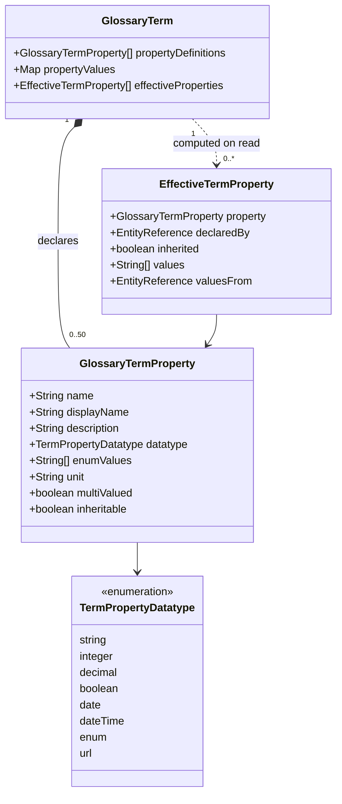
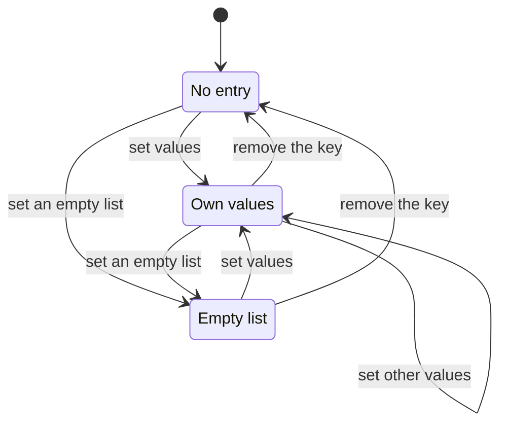
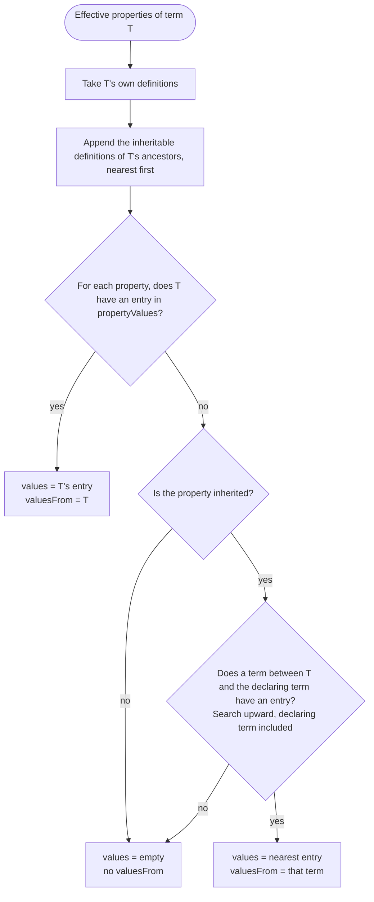
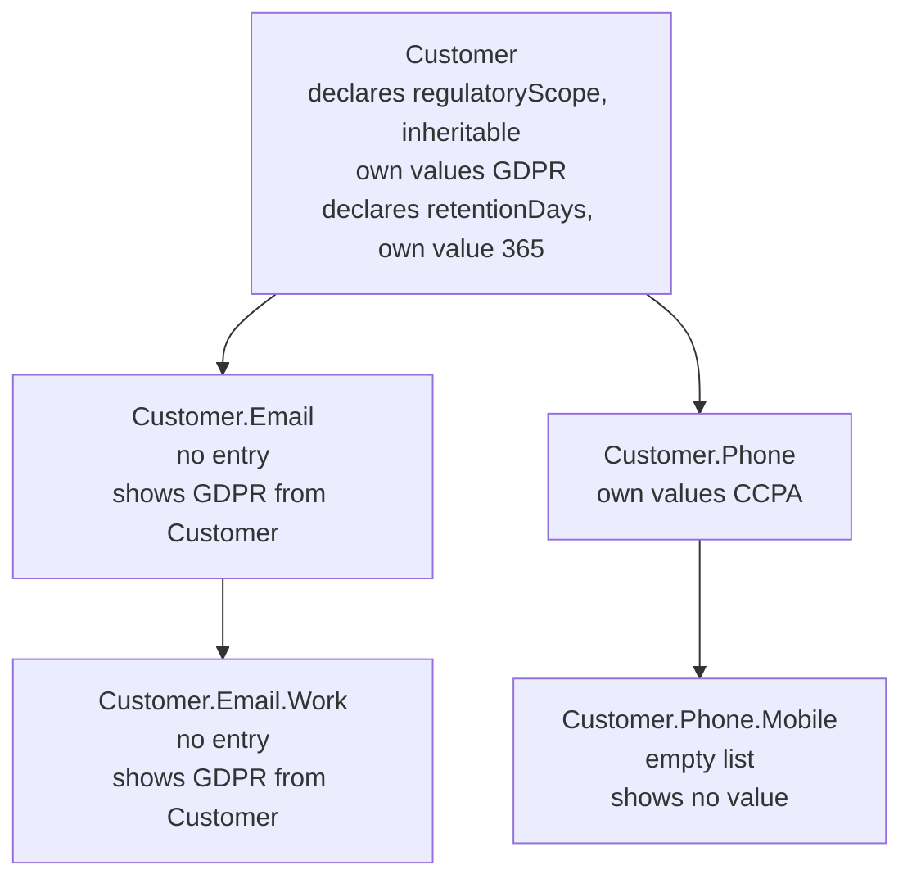
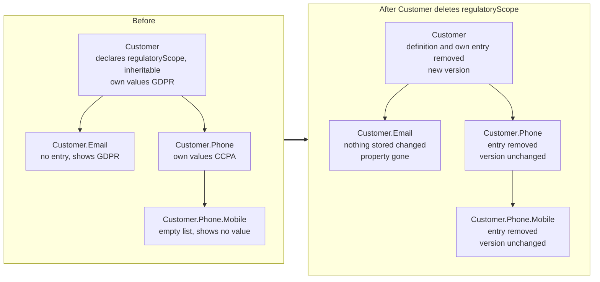
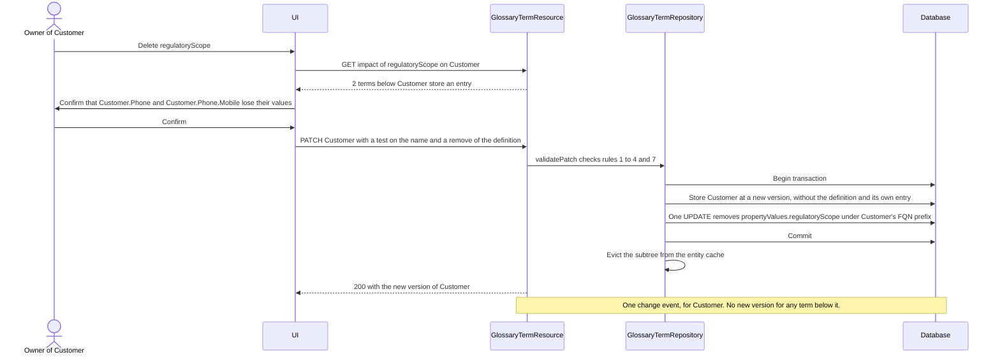
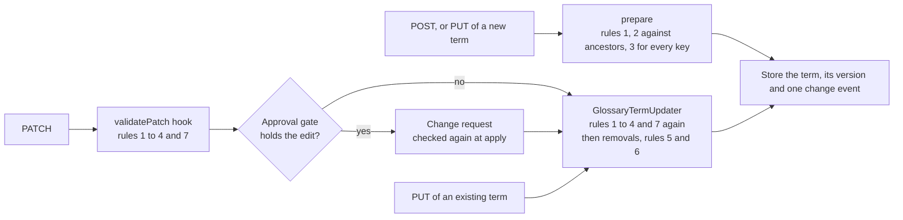
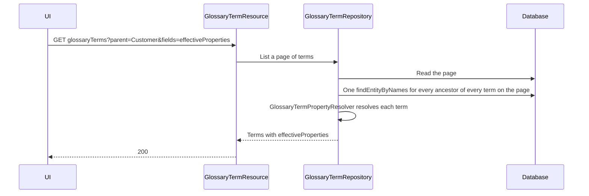

# Glossary term properties design

- **Status:** design for review, 2026-11-12. Implementation has not started.
- **Owner:** Sriharsha Chintalapani
- **Records:** ADR:2026-11-12-glossary-terms-declare-their-own-properties-and-values and v2 of
  ADR:2026-10-17-glossaries-do-not-own-ontology-models.
- **Revisions of the approved plan:** listed in [Changes from the approved plan](#changes-from-the-approved-plan).

## Summary

A glossary term can declare typed properties, set values for them, and choose for each property
whether the terms below it inherit it. Governance teams use this to keep a property set per term,
for example on the terms they track as critical data elements, and a nested term inherits some of
its parent's properties and adds its own. Catalogs use it to give each list of terms, such as
applications or business processes, its own property set.

Definitions and values live in the term's JSON. They version, diff and go through approval with the
term. Custom properties and `extension` do not change, and the design adds no entity, table,
relationship type or DDL.

Deleting a property at the term that declares it removes the property, and every value stored for
it, from that term's whole subtree in one transaction.
[Deleting an inherited property at the top](#deleting-an-inherited-property-at-the-top) walks
through that case.

## Goals

- Any glossary term can declare up to 50 typed properties and set their values when the term is
  created or edited.
- The declaring term decides, per property, whether the terms below it inherit the property and its
  value.
- A term below can override an inherited value, clear it, or reset it to the inherited value.
- Every change versions with the term, and a glossary approval workflow can hold it.
- Existing clients, stored terms and custom properties keep working unchanged.

## Non-goals for v1

- Searching or filtering terms by property value.
- Declaring properties on a glossary.
- Term property values on data assets. Assets keep custom properties and glossary labels.
- OWL semantics. Term properties are not ontology properties, see [Native ontologies](#native-ontologies).

## Background

### Why the term holds its properties

Custom properties extend an entity type's schema. An admin defines one on `glossaryTerm`, and it
applies to every glossary term. Its values live in `entity_extension` under
`<entityType>.customProperties.<name>`. That fits a field that every entity of a type shares. It
does not fit a property that one term declares for itself and its subtree.

Two requests need that second kind of property.
- A governance program keeps a property set per term, for example for the terms it tracks as
  critical data elements. A nested term inherits some of its parent's properties and adds its own.
- A bank models applications and business processes as separate lists of terms,
  each with its own properties.

An ontology class works the same way. It declares properties, and its subclasses get them. This
design takes the shape of a native ontology DATA property and puts it on the term, as an optional
part of `glossaryTerm`.

### What exists to build on

- Native ontologies define a DATA property as an `ontologyProperty` with `kind`, `range` (an XSD
  datatype IRI), `enumValues`, `unit` and `isIdentifier` (`entity/data/ontologyProperty.json`). An
  enum value is an `OntologyLiteral`, a lexical string with an optional datatype IRI
  (`type/ontologyExpression.json:34`). Native ontologies store no values. Values come from source
  columns bound to the property.
- `OntologyPropertyRules` (`ontology/OntologyPropertyRules.java`) limits `unit` to 1 to 256
  characters and an enumeration to 2 to 1,000 unique values.
- `OwlDatatypeSupport.isValidLiteral` (`ontology/OwlDatatypeSupport.java:62`) checks a lexical form
  with Jena's XSD datatypes. Its OWL 2 allow-list (`:14-44`) leaves out `xsd:date`.
- The Ontology Studio offers `string`, `integer`, `decimal`, `boolean`, `date`, `dateTime` and `enum`
  (`STUDIO_DATATYPES`, `utils/governance/ontology/OntologyStudioModel.utils.ts:92`).
- Glossary terms carried `attributes` and a computed `effectiveAttributes` until #35672 removed them
  on 2026-10-18. They held definitions only, with no values, and only the Ontology Explorer
  inspector showed them. `GlossaryModelBoundaryTest` still rejects both names, and the 2.1.0
  migration strips them from stored JSON, so the new fields take new names.

Three earlier designs for this need were dropped: a separate `criticalDataElement` entity, a
glossary type that switched properties on, and glossary term custom properties scoped to terms. [Alternatives considered](#alternatives-considered)
gives the reasons.

## Model



### Property definition

`type/glossaryTermProperty.json` defines one property.

| Field | Rule |
|---|---|
| `name` | Required. Follows `customPropertyName`. Unique ignoring case among the term's own definitions. It never changes, because values are keyed by it. |
| `displayName` | Optional label. It can change at any time. |
| `description` | Optional markdown. |
| `datatype` | Required. `string`, `integer`, `decimal`, `boolean`, `date`, `dateTime`, `enum` or `url`. It never changes after the property is declared. |
| `enumValues` | Required for `enum` and rejected otherwise. 2 to 1,000 unique values. |
| `unit` | Optional display unit, 1 to 256 characters. Nothing converts between units. |
| `multiValued` | Allowed for `string` and `enum` only. The default is false. |
| `inheritable` | When true, every term below the declaring term gets the property and can inherit its value. The default is true, and the UI does not expose it. |

`customPropertyName` (`type/basic.json:129-135`) is the rule custom property names already follow.
A name starts with a letter or a digit. It cannot contain `/` or `~`, which JSON Patch paths
reserve, or `"` and `\`.

### Term fields

`glossaryTerm.json` gains three optional fields, and `createGlossaryTerm.json` gains the first two.

| Field | Stored | Content |
|---|---|---|
| `propertyDefinitions` | Yes | The properties this term declares, at most 50. |
| `propertyValues` | Yes | A map from property name to a list of values, `Map<String, List<String>>` in Java through `existingJavaType`. A key matches a definition name exactly. |
| `effectiveProperties` | No | Computed on read. One entry for each property the term has, declared or inherited. |

A GET returns these fields only when `fields` names them, the way it treats `relatedTerms` and
`childrenCount` (`GlossaryTermRepository.clearFields`, `:757`). A term list stays the size it is
today.

An `effectiveProperties` entry has five fields.
- `property` is the definition.
- `declaredBy` is a reference to the declaring term.
- `inherited` is true when `declaredBy` is another term.
- `values` is the list that applies to this term. It is empty when the property has no value here.
- `valuesFrom` is a reference to the term whose entry supplied `values`. It is absent when no entry
  applies.

### Values

A value is a lexical form, like `OntologyLiteral.value`. The server checks each value with Jena's
XSD datatype for the property's `datatype`, as `OwlDatatypeSupport.isValidLiteral` does, but
without the OWL 2 allow-list, so `date` maps to `xsd:date`. It stores the value as sent. An `enum`
value must be one of `enumValues`. A `url` value must be an absolute `http` or `https` URI with a
host.

| `datatype` | Checked as | Example value |
|---|---|---|
| `string` | `xsd:string` | `Payments team` |
| `integer` | `xsd:integer` | `365` |
| `decimal` | `xsd:decimal` | `99.95` |
| `boolean` | `xsd:boolean` | `true` |
| `date` | `xsd:date` | `2026-11-12` |
| `dateTime` | `xsd:dateTime` | `2026-11-12T09:30:00Z` |
| `enum` | Membership in `enumValues` | `GDPR` |
| `url` | Absolute `http` or `https` URI | `https://wiki.example.com/gdpr` |

A value holds at most 2,048 characters. A single-valued property holds one value, and a
multi-valued property holds at most 100. Because every value is a string, each JSON field always
holds one type, and the generated Java, Python and TypeScript models need no untyped `Object`.

### Value states

For each property in scope, a term's `propertyValues` is in one of three states.



- **No entry.** The term inherits. For an inheritable property, it takes the nearest entry above
  it, up to and including the declaring term. For its own property with no entry, it has no value.
- **Own values.** The term overrides what it would inherit.
- **Empty list.** The term deliberately has no value. Terms below it that have no entry inherit
  that absence.

The UI names the three transitions Override, Clear and Reset.

### Resolution

A term's effective properties are its own definitions, in declared order, followed by the
inheritable definitions of its ancestors, nearest ancestor first. Each property then takes its
values as the chart shows.



The ancestors come from `FullyQualifiedName.split` of the term's FQN. One `findEntityByNames` call
loads the ancestors of every term on a page. Reindex never asks for `effectiveProperties`.

Two edge cases come only from concurrent edits, see [Concurrent edits](#concurrent-edits).
- If two definitions of one name end up in scope, the nearest one wins. A term's own definition
  beats an ancestor's, and a nearer ancestor's beats a farther one's.
- A stored entry that names no effective property is ignored on read.

### Example

`Customer` declares an inheritable, multi-valued enum and an integer that only it uses. The terms
below it show each value state.



`Customer` as stored:

```json
{
  "name": "Customer",
  "propertyDefinitions": [
    {
      "name": "regulatoryScope",
      "datatype": "enum",
      "enumValues": ["GDPR", "CCPA"],
      "multiValued": true,
      "inheritable": true
    },
    { "name": "retentionDays", "datatype": "integer", "unit": "days" }
  ],
  "propertyValues": { "regulatoryScope": ["GDPR"], "retentionDays": ["365"] }
}
```

`Customer.Email.Work` declares and stores nothing. Its `effectiveProperties` holds one entry.
`retentionDays` is absent, because it is not inheritable.

```json
{
  "property": { "name": "regulatoryScope", "datatype": "enum", "enumValues": ["GDPR", "CCPA"],
                "multiValued": true, "inheritable": true },
  "declaredBy": { "type": "glossaryTerm", "fullyQualifiedName": "\"Data Glossary\".Customer" },
  "inherited": true,
  "values": ["GDPR"],
  "valuesFrom": { "type": "glossaryTerm", "fullyQualifiedName": "\"Data Glossary\".Customer" }
}
```

## API

Every endpoint below exists today except the impact endpoint.

**Create a term with properties.** `POST /api/v1/glossaryTerms` accepts `propertyDefinitions` and
`propertyValues`. A new term can set values for its own properties and for the inheritable
properties of its new parent's ancestors.

```json
{
  "glossary": "Data Glossary",
  "parent": "\"Data Glossary\".Customer",
  "name": "Phone",
  "description": "A phone number that reaches a customer.",
  "propertyValues": { "regulatoryScope": ["CCPA"] }
}
```

**Read effective properties.** `GET /api/v1/glossaryTerms/{id}?fields=effectiveProperties`
returns the list described under [Term fields](#term-fields). The list endpoint takes the same
`fields` value.

**Set, clear and reset a value.** A PATCH addresses a value by property name.

```json
[{ "op": "add", "path": "/propertyValues/regulatoryScope", "value": ["CCPA"] }]
```

The value `[]` clears it. `{ "op": "remove", "path": "/propertyValues/regulatoryScope" }` resets
it. When a term has no `propertyValues` map yet, the first patch adds the whole map, as
`fast-json-patch`'s `compare` does.

**Declare, edit and delete a definition.** Definitions form an array, so a PATCH addresses one by
index. The UI guards the index with a `test` operation on the name. If the list moved since the UI
read it, the server returns 400, and the UI rebuilds the patch from a fresh copy, at most three
times. `patchCustomPropertyByName` does the same for custom properties
(`rest/metadataTypeAPI.ts:143-175`).

```json
[
  { "op": "test", "path": "/propertyDefinitions/0/name", "value": "regulatoryScope" },
  { "op": "remove", "path": "/propertyDefinitions/0" }
]
```

**Preview the effect of a removal (new).**
`GET /api/v1/glossaryTerms/{id}/propertyDefinitions/{name}/impact` returns how many terms in the
declaring term's subtree store an entry for the property, and up to 20 of them. The UI calls it
before it confirms a delete, turning off inheritance, or a change of enumeration or
multiplicity. It needs the permission to read the declaring term.

```json
{
  "termsWithEntries": 2,
  "sample": [
    { "type": "glossaryTerm", "fullyQualifiedName": "\"Data Glossary\".Customer.Phone" },
    { "type": "glossaryTerm", "fullyQualifiedName": "\"Data Glossary\".Customer.Phone.Mobile" }
  ]
}
```

**Errors.**

| Status | Cause |
|---|---|
| 400 | A definition breaks the definition table, a value fails its datatype, a key names no effective property, or a limit is exceeded. A `test` operation that fails also returns 400. |
| 403 | The user lacks `EditGlossaryTermProperties` on the term. |
| 409 | A name clashes in some term's effective properties, a shape change would break a stored value, or a move would leave values that no property covers. The message names up to 20 terms and gives the total. |
| 412 | The request sent `If-Match`, and the term changed since that version (`EntityResource.patchInternal`, `:1346-1356`). |

## Write rules

A property's scope is the declaring term, plus its subtree when the property is inheritable.

1. **Definitions.** Each definition follows the definition table. Names are unique ignoring case
   among the term's own definitions. A term declares at most 50, and its serialized definitions and
   values together take at most 256 KiB. A violation returns 400.
2. **Unique effective names.** Within the effective properties of any term, names are unique
   ignoring case, and no definition shadows another. A clash returns 409. Three writes can cause
   one.
   - Declaring a name that an ancestor makes inheritable.
   - Making a property inheritable, by declaring it so or by turning the flag on, while a term
     below declares that name.
   - Moving a term under ancestors that make one of the subtree's names inheritable.
3. **Values.** Each key whose values change names an effective property of the term, and each of
   its values passes the checks under [Values](#values). A violation returns 400. Removing a key is
   always allowed. A stored key that names no effective property is removed on the term's next
   write, and that write's change description records the removal.
4. **Shape changes.** A change to `datatype` returns 400, because a property's datatype is fixed
   when it is declared. A change to `enumValues` or `multiValued` re-checks every stored value in
   the property's scope. If one breaks, the change returns 409 and stores nothing.
5. **Removals.** Deleting a definition removes the declaring term's own entry and, for an
   inheritable property, every entry for it below the declaring term. Turning `inheritable` off
   removes the entries below and keeps the declaring term's own. Stored values never block either
   change.
6. **Fresh scope.** Declaring an inheritable property, or turning `inheritable` on, first removes
   any entry for that name below the declaring term. Rule 3 never lets such an entry in, so only a
   concurrent edit can leave one, and it must not reappear as a value of the new property.
7. **Moves.** A move re-checks rules 2 and 3 for the moved subtree against its new ancestors. A
   violation returns 409. A move never removes a value.
8. **Subtree work.** Checks that read the subtree page through it by `fqnHash` prefix, 1,000 terms
   at a time. Rules 5 and 6 remove entries with one set-based `UPDATE` inside the write
   transaction.

The removals in rules 5 and 6 include soft-deleted terms, so restoring a term can never bring back
a removed value. They write no version and no change event for the terms below, see
[Deleting an inherited property at the top](#deleting-an-inherited-property-at-the-top) for why.

## Property lifecycle

| Event | Allowed when | Declaring term | Terms below | New versions |
|---|---|---|---|---|
| Declare a property | Rules 1 and 2 pass | Gains the definition and an optional value | If inheritable, they show it. Stale entries for the name are removed first (rule 6). | Declaring term |
| Set, clear or reset a value | Rule 3 passes for the key | Any term in scope can be the one edited | Terms below the edited term that have no entry follow the change | Edited term |
| Edit `displayName`, `description` or `unit` | Rule 1 passes | Definition updated | Show the new label | Declaring term |
| Change `datatype` | Never (400) | Delete the property and declare a new one | | |
| Change `enumValues` or `multiValued` | No stored value in scope breaks (rule 4) | Definition updated | Unchanged | Declaring term |
| Turn `inheritable` on | Rule 2 passes below | Definition updated | Show the property. Stale entries removed first. | Declaring term |
| Turn `inheritable` off | Always | Keeps the definition and its own entry | Lose the property and their entries | Declaring term only |
| Delete a definition | Always | Loses the definition and its own entry | If it was inheritable, lose the property and their entries | Declaring term only |
| Rename a property | Never | Edit `displayName` instead | | |
| Rename a term | As today | Nothing stored changes | Nothing stored changes. `declaredBy` and `valuesFrom` resolve to the new FQNs on read. | As today |
| Move a term | Rule 7 passes | Keeps its definitions and values | Keep their values. Inherited properties now come from the new ancestors. | As today |
| Soft-delete a term | `recursive=true` when it has children | Marked deleted, values kept | Deleted with it | As today |
| Restore a term | As today | Values as stored | Restored with it | As today |
| Hard-delete a term | `recursive=true` when it has children | Removed | Removed | None |

"Always" means that stored values never block the change. The user still needs `EditGlossaryTermProperties` on the
declaring term.

### Deleting an inherited property at the top

`Customer` deletes `regulatoryScope`, which it declared as inheritable. The owner deletes the
property, so its values go with it. Values exist only because the definition does, and the
definition's owner controls their lifetime.





What each party sees afterwards:
- **Readers of any term in the subtree.** `effectiveProperties` no longer lists `regulatoryScope`.
  That holds from the commit on, because resolution finds no definition, whether or not a stored
  entry remains.
- **Owners of the terms below.** Their terms no longer store the entry. Their version numbers and
  histories do not change. `Customer`'s history records the deletion, with the definition and
  `Customer`'s own values as the old value.
- **Event consumers.** One change event, for `Customer`, lists the deleted definition and
  `propertyValues.regulatoryScope`. Nothing is published for the terms below.
- **Soft-deleted terms below `Customer`.** Lose their entries too, so a later restore brings back
  no stale value.
- **Anyone who declares `regulatoryScope` again.** Gets a new, empty property. Rule 6 removes any
  entry a concurrent edit left behind before the new definition takes effect.

The deletion cannot be undone. The confirmation names the count from the impact endpoint, and the
values of the terms below are not kept anywhere. The terms below get no new version, for three
reasons.
- The intent is recorded once, on the term whose owner acted.
- A version per term below would multiply writes, version rows and reindexing by the number of
  terms that held a value.
- The codebase already removes dependent values this way. Deleting a custom property deletes every
  entity's value for it (`TypeRepository.java:470-500`), and deleting a glossary term deletes its
  labels from every asset (`GlossaryTermRepository.java:2021`), without new versions of the
  entities that held them.

The removal is one set-based statement, `JSON_REMOVE` on MySQL and the `#-` operator on Postgres,
scoped by the declaring term's `fqnHash` prefix. A term rename rewrites the FQNs of its subtree
the same way (`glossaryTermDAO().updateFqn`, `GlossaryTermRepository.java:2694`) and evicts the
subtree from the entity cache with `invalidateCacheForRenameCascade` (`:2689-2690`). The removal
reuses that eviction. A property name never reaches SQL as text. MySQL takes the JSON path as a
bound parameter, and the name can hold no `"` or `\` to escape out of its quotes. Postgres takes
the path as a bound text array.

### Turning inheritance off

Turning `inheritable` off at `Customer` is the same removal for the terms below. `Customer` keeps
the definition and its own values, and the terms below lose the property and their entries. The
UI asks for the same confirmation.

### Changing a property's shape

A property's `datatype` never changes. The UI picks it when the property is created, and a change
returns 400. A change to `enumValues` or `multiValued` keeps every value or changes nothing.
- Adding an enum value or allowing multiple values always passes.
- Removing an enum value passes only if no term in scope stores it.
- Disallowing multiple values passes only if no term in scope stores more than one.

The 409 names up to 20 terms that hold a breaking value. A deletion states its intent to remove
values. A shape change does not say what should happen to a value it breaks, for example whether
`CCPA` should become `US-CA` or disappear, so the owner decides first.

### Moving a term

A move keeps every stored value. Properties inherited from the old ancestors disappear from the
moved subtree, and the new ancestors' inheritable properties appear. The move returns 409 in two
cases.
- A name clashes. A term in the moved subtree declares a name that a new ancestor makes inheritable.
- A value is left without a property. A term in the moved subtree stores an entry for a property
  that none of its new ancestors declares compatibly.

A value inherited from the old ancestors and stored in the moved subtree moves with it when a new
ancestor declares a property of that name, and the value is valid for it. The checks run before
`moveAsync` starts its job, so the caller gets the 409 rather than a failed job.

### Renaming

A property's `name` never changes. Its `displayName` can change, and every term in scope shows the
new label at once. A term rename changes FQNs only. Values are keyed by property name, and
`declaredBy` and `valuesFrom` are computed on read, so nothing stored changes.

### Deleting and restoring terms

A term with children can be deleted only with `recursive=true` (`EntityRepository.java:6019-6020`),
so a declaring term and its subtree are deleted together. No live term is left with a deleted
ancestor. Restoring a term restores its children with it (`restoreChildren`,
`EntityRepository.java:8255`). Removals under rules 5 and 6 include soft-deleted rows, so values
come back exactly as the subtree held them, without any entry a removal deleted in the meantime.

### Approval-held edits

Both stored fields become workflow trigger fields. In a glossary whose approval workflow enforces
review, a property edit by someone other than a reviewer becomes a change request, as other term
edits do. The `validatePatch` hook runs when the request is submitted, so an invalid edit fails at
once instead of after approval.

An approved change applies later. `ChangeApplyService` applies it only if no gated field it changes
has moved since submission, and only if the result still passes the validation a PATCH runs
(`ChangeApplyService.applicability`). If an ancestor deleted the property in between, the request
reports that it can no longer be applied, with the rule's message.

### Concurrent edits

No rule takes a row lock beyond what each write already takes.
- **Different properties on one term.** Both edits apply, because a PATCH addresses a value by
  property name.
- **The same value on one term.** The last write wins. Both writes are versions of the term.
- **Definitions on one term.** The `test` operation on the name rejects a patch built from an older
  list, and the UI rebuilds it.
- **A removal at the declaring term while a term below sets a value.** The value can be written
  after the removal commits. Resolution ignores it, the term's next write removes it (rule 3), and
  declaring the name again removes it first (rule 6).
- **Two terms declare one name at once.** Each check can pass before the other commits. Resolution
  keeps the nearest definition, and the next definitions write on either term returns 409 until one
  is removed.

A client that sends `If-Match` gets 412 when the term changed since it read it.

## Where the rules run



| Check point | Runs for | Rules |
|---|---|---|
| `GlossaryTermRepository.prepare` | Every create and update | 1 and 2 against ancestors. On create, 3 for every key. Sets `effectiveProperties` to null. |
| `validatePatch(original, updated, patch)` override (`EntityRepository.java:1568`, called at `:5392`) | PATCH, approval preview at submission (`:5303-5307`), approval check at apply (`:5311-5314`) | 2 against descendants, 3 for changed keys, 4 and 7 |
| `GlossaryTermUpdater.entitySpecificUpdate` (`GlossaryTermRepository.java:2455`) | Every update, PATCH or PUT, inside the write transaction | The checks of `validatePatch` again, then 5 and 6 |
| `validateMoveOperation` (`:3079`) | `moveAsync`, before the job starts | 7 |
| `EntityCsv.createEntity` after `findMatchForImport` (`EntityCsv.java:1192`) | A CSV row that changes a term's parent, dry runs included | 7 |

The updater repeats the checks of the hook for two reasons. A PUT never calls the hook, and an
approved change applies against state that may have moved since the hook ran. For a value edit,
the repeat costs one ancestor query.

Setting `effectiveProperties` to null in `prepare` means a PUT that sends back a GET response
stores nothing computed and puts nothing computed in the change event.

The rules live in three pure classes. `GlossaryTermPropertyRules` checks definitions and clashes.
`GlossaryTermPropertyResolver` computes effective properties. `GlossaryTermPropertyValues` checks
lexical forms. `GlossaryTermRepository` loads data, calls them, and runs the removals.

The read path costs one query per page, whatever the page size.



## Write paths that must keep the fields

A new term field can get lost in several known ways. Each item closes one.
- Both stored fields join `getFieldsKeptByPut` (`GlossaryTermRepository.java:1162`) and follow the
  PUT rule of `extension` and `style` (`EntityRepository.updateExtension`, `updateStyle`). A PUT that
  omits a field keeps the stored value. A PUT that sends a value replaces it, so `[]` or `{}` clears
  it and runs the same removals as a PATCH. A PUT from a bot never removes stored definitions or
  values. The schemas give `propertyDefinitions`, `effectiveProperties` and `enumValues`
  `"default": null`, as `entityReferenceList.json` does for owners, so an omitted field stays null
  in Java instead of becoming an empty list. Ingestion, the SDK, `GlossaryRdfImporter.persistGlossary` and
  `OntologyChangeOperationExecutor.upsertTerm` send such PUTs. The removed `attributes` was not in
  this set, so those PUTs cleared it.
- Both join `UPDATE_FIELDS` and `PATCH_FIELDS` (`GlossaryTermRepository.java:161-164`), so PUT and
  PATCH load them before they apply a change.
- `clearFields` (`:757`) returns all three fields only when `fields` names them.
- A field fetcher (`:197`) serves `effectiveProperties` to list endpoints, and `setFields` calls it
  with a one-item list.
- `GlossaryCsv.createEntity` (`GlossaryRepository.java:309-357`) copies both stored fields from the
  stored term. A CSV update writes whole rows without the updater (`updateManyEntitiesForImport`,
  `EntityRepository.java:4622`), so the fields would otherwise be lost. CSV has no column for them.
- Both join the `glossaryTerm` entry of `workflowTriggerFields.json` (`:297-307`).
- `GlossaryTermIndex.getExcludedFields` (`:29`) and `RdfPropertyMapper` leave out all three fields.
  The RDF mapper would otherwise store them as JSON literals (`RdfPropertyMapper.java:512`).
  Glossary RDF stays SKOS only.

## Permissions

Editing definitions or values needs the `EditGlossaryTermProperties` operation on the term, a new
value of `MetadataOperation`. `GlossaryTermResource` registers it as an operation of the
`glossaryTerm` resource and maps both fields to it with `ResourceRegistry.mapEntityFieldOperation`,
as `TaskResource` does for its fields, so `JsonPatchUtils.operationByDeclaredField` resolves a patch
of either field to it. `EditAll` and `All` include it. No default role or policy gains it, and no
migration runs. An admin grants it through a policy rule, like any other operation. A PUT is
authorized as every PUT is (`EntityUtil.createOrUpdateOperation`).
- The default organization policy gives an owner every operation on what they own
  (`OrganizationPolicy.json:11-16`). Owners can edit their terms' properties.
- The default Data Steward policy grants neither `EditAll` nor `EditGlossaryTermProperties`
  (`DataStewardPolicy.json:13`). An organization that wants stewards to edit term properties adds a
  rule that grants the operation.
- A user who can create a term can declare properties and set values in the create request.

Removals below the declaring term need `EditGlossaryTermProperties` on the declaring term only, even where the user
cannot edit the terms that lose a value. The definition's owner controls the lifetime of its
values, as a custom property's owner does when deleting it removes every entity's value.

Reading `effectiveProperties` needs only the permission to read the term. An inheritable property
and its values are visible to everyone who can read a term below the declaring term. Marking a
property inheritable publishes it to that audience.

## Backward compatibility

### API and clients

The API change is additive. Two request fields, three response fields, three `fields` values and
one endpoint are new. No field is removed, renamed or given a new default, and a term without
properties reads and writes exactly as before.

| Client | Effect |
|---|---|
| Java SDK, `openmetadata-sdk` | Its HTTP client ignores unknown response fields (`OpenMetadataHttpClient.java:42`). A PUT from it omits the new fields, and the server keeps them. An SDK from an earlier release keeps working. |
| Python SDK and ingestion | `validate_versions` refuses a client whose major and minor version differ from the server's (`ingestion/src/metadata/ingestion/ometa/mixins/server_mixin.py:141-153`). Only a client generated from the new schema talks to a server that has it. |
| UI | Ships with the server. |

For the Python rule, the schema change ships in a minor release, never in a patch release.

### Stored data and upgrade

- No DDL and no data migration. Stored terms have none of the new keys and resolve to no
  properties.
- No search mapping change and no reindex, because `GlossaryTermIndex` excludes all three fields.
- Version rows gain the new keys only for versions written after a term gains properties.

### Downgrade

The server parses entity rows strictly. `EntityDAO.jsonToEntity` calls `JsonUtils.readValue`
(`EntityDAO.java:1212`), and that mapper fails on unknown properties. Only `OBJECT_MAPPER_LENIENT`
turns the check off (`JsonUtils.java:147-149`). A server from an earlier release therefore cannot
load a term that stores either new field, and a list page that holds one fails. Version rows in
`entity_extension` fail the same way.

This design adds no down-migration. Before an earlier server runs against an upgraded database, an
operator must strip both keys, which deletes every term property. The 2.1.0 migration removed the
retired term fields the same way (`bootstrap/sql/migrations/native/2.1.0/mysql/schemaChanges.sql:1194-1196`
and `postgres/schemaChanges.sql:900-902`).

MySQL:

```sql
UPDATE glossary_term_entity
SET json = JSON_REMOVE(json, '$.propertyDefinitions', '$.propertyValues')
WHERE JSON_CONTAINS_PATH(json, 'one', '$.propertyDefinitions', '$.propertyValues');

UPDATE entity_extension
SET json = JSON_REMOVE(json, '$.propertyDefinitions', '$.propertyValues')
WHERE jsonSchema = 'glossaryTerm'
  AND JSON_CONTAINS_PATH(json, 'one', '$.propertyDefinitions', '$.propertyValues');
```

Postgres:

```sql
UPDATE glossary_term_entity
SET json = json - ARRAY['propertyDefinitions', 'propertyValues']
WHERE jsonb_exists_any(json, ARRAY['propertyDefinitions', 'propertyValues']);

UPDATE entity_extension
SET json = json - ARRAY['propertyDefinitions', 'propertyValues']
WHERE jsonSchema = 'glossaryTerm'
  AND jsonb_exists_any(json, ARRAY['propertyDefinitions', 'propertyValues']);
```

### Neighbouring features

- **Custom properties.** Unchanged. A glossary term keeps `extension` and the type-level custom
  properties defined on `glossaryTerm`. The two kinds never share storage or a tab, so a term
  property may have the same name as a custom property.
- **Retired fields.** The new fields use new names. `GlossaryModelBoundaryTest` stays unchanged,
  and the 2.1.0 strip matches only the retired keys.
- **Search and RDF.** Both leave the three fields out.
- **CSV.** Export columns do not change. Importing an existing term keeps its stored properties. A
  term created by CSV has none.
- **Change events.** A write to the declaring term records `propertyDefinitions` changes matched by
  name, and each changed value as `propertyValues.<name>`. Removals below the declaring term publish
  nothing.
- **Approval workflows.** A workflow trigger with no include list starts holding property edits,
  because both fields join the trigger fields. A trigger with an include list holds them only if it
  names them. It can name one property as `propertyValues.<name>`, because
  `WorkflowTriggerFilters.matchesField` also matches a field path below a trigger field.

## Performance and limits

| Limit | Value | Reason |
|---|---|---|
| Definitions per term | 50 | Enough for a governed term's template. The UI lists them without paging. |
| Enum values per definition | 2 to 1,000, unique | The rule `OntologyPropertyRules` applies to native enumerations. |
| Unit | 1 to 256 characters | The same ontology rule. |
| Value | 2,048 characters | Fits a URL or a short note. |
| Values per multi-valued property | 100 | Fits any realistic multi-select. |
| Serialized definitions and values per term | 256 KiB | Bounds the row, and a page of 50 terms that asks for both fields to 12.5 MiB. |
| Terms named in a 409 or in the impact sample | 20, plus the total | Keeps error and preview bodies small. |
| Subtree page | 1,000 terms | Bounds memory for the subtree checks. |

| Operation | Extra database work |
|---|---|
| Read without the new fields | None. |
| Read with `propertyDefinitions` or `propertyValues` | None. They are in the row. |
| Read with `effectiveProperties` | One query per page, for the ancestors of every term on it. |
| Set, clear or reset a value | One query for the term's ancestors, at most twice. |
| Declare or edit a property that is not inheritable | One query for the term's ancestors. |
| Declare, edit, turn on or turn off an inheritable property | The ancestor query, plus a subtree scan in pages of 1,000. |
| Delete a definition | The declaring term's write plus one `UPDATE` for the subtree. |
| Move a term | A scan of the moved subtree in pages of 1,000. |

The subtree work happens only when a definition that reaches below the term changes, or when a term
moves. A value edit never reads the subtree.

## Security

- **Bounded input.** Every list and string has a cap, and the 256 KiB per-term cap bounds the rest,
  as ADR:2026-11-03-input-parsing-is-bounded requires.
- **Names in paths and SQL.** `customPropertyName` excludes `/` and `~`, so a name is safe inside a
  JSON Patch path. The removal binds the JSON path as a parameter, see
  [Deleting an inherited property at the top](#deleting-an-inherited-property-at-the-top).
- **Rendering.** The UI renders values as plain text. Definition descriptions render through the
  same markdown viewer as term descriptions.
- **Visibility.** An inheritable property is visible to every reader of the subtree, see
  [Permissions](#permissions).
- **No new secret, network call or file access.**

## UI

The UI uses core components with `tw:` classes, i18n keys in `en-us.json` synced with `yarn i18n`,
file names from `DEVELOPER_HANDBOOK.md`, and a flag for `EditGlossaryTermProperties` derived in
`useEntityPermissions`.

**Term page.** Properties sit in a section of the Overview tab, above Synonyms. There is no
separate tab. A summary line reads "N defined here · M inherited from parent terms · K child terms
inherit these". The Source column reads "Defined here", "↳ <term>", "Overridden here" or
"Overridden in <term>".

```text
Properties          2 defined here · 1 inherited from parent terms · 3 child terms inherit these

Property           Type      Value        Source
Regulatory scope   Enum      CCPA         Overridden here           Edit  Reset
SLA tier           Enum      Gold         ↳ Application             Edit
Retention          Number    365          Defined here              Edit  Delete
```

- Edit opens "Edit property" for the term's own definitions, and "Override value for this term"
  for inherited ones. Reset ("Reset to inherited value") removes the term's own entry and shows
  only when the term overrides the value. Delete shows only for the term's own definitions.
- Before a delete, the UI calls the impact endpoint, and the confirmation names how many child
  terms lose a value.
- With no properties, the section reads "No properties yet. Add one here, and child terms will
  inherit it."
- A 409 shows the server's message, which names the terms involved.

**Property modal.** One modal has three modes.
- "Add property" asks for a name, a type, the allowed values for Enum (comma-separated), a default
  value and an optional description. It notes "You can't change the type once the property is
  created."
- Edit changes the label and locks the type. It notes "Child terms that haven't overridden this
  value will show the new value."
- "Override inherited value" locks the name and asks for the value for this term.

The types map to datatypes as Text to `string`, Number to `decimal`, Date to `date`, Boolean to
`boolean` (shown as True and False), Enum to `enum` and URL to `url`. The `name` key comes from the
first label, sanitized to `customPropertyName`. Later edits change `displayName` only.

**Header.** An Add menu offers "Child term" ("Inherits this term's properties") and "Property"
("Define a new property on this term").

**Create form.** `AddGlossaryTermForm` gains a Properties section. `GlossaryTermDrawer`, which
builds the form (`useGlossaryTermIntakeForm`, `:73`), also fetches the parent's
`effectiveProperties` and lists them as "↳ <term>". Add-property rows declare new properties with a
name, type, enum options and value. The section notes "Pick each property's type now; you can't
change it after the term is created. Child terms will inherit these properties."

**Terms table.** The glossary's terms table gains a Properties column with "N own" and
"N inherited".

## Native ontologies

ADR:2026-10-17-glossaries-do-not-own-ontology-models removed OWL modeling from glossaries. Its v2
amendment allows term properties, because they are governance metadata on a term, not ontology
definitions. They have no IRIs, the RDF projection leaves them out, and they do not bring back
`attributes` or `effectiveAttributes`. Native ontologies stay the only place to author OWL
properties and axioms. Term properties and native DATA properties share datatypes, enumerations
and units, so a later change could promote one to the other.

## Separate lists of terms

Only terms declare properties. A user nests each list under one root term that declares the
shared properties as inheritable. Glossary `Applications` holds root term `Application`, which
declares `slaTier` (`enum` Gold, Silver or Bronze) as inheritable. Every application term below it
shows `slaTier` and sets its own value. Related terms link applications, processes and data terms,
and glossary labels link terms to data assets, as they do today.

Custom properties on the glossary entity itself already work in the API (`glossary.json:120`). The
UI lacks a Glossary entry under Settings > Custom Properties (`GlobalSettingsClassBase.ts:901` lists
only Glossary Term) and a Custom Properties tab on the glossary page. Delivery step 5 adds both.

## Alternatives considered

| Option | Why it lost |
|---|---|
| A `criticalDataElement` entity with asset mappings it owns | It duplicated the glossary hierarchy, approval, labels and the Assets tab. |
| A glossary type that switches on term-declared properties | The type added nothing the properties need. |
| Glossary term custom properties, scoped to glossaries and terms | A custom property extends a type's schema. Scoping it per instance would make every reader of `extension` resolve names per term, and it confuses custom properties with instance data. |
| Native ontology DATA properties bound to terms | Native ontologies store no values, authoring them needs the Ontology Studio, and ADR:2026-10-17-glossaries-do-not-own-ontology-models keeps glossaries out of OWL modeling. |
| Properties declared on the glossary | A root term covers the same lists, and terms-only keeps one place to declare. |

For deleting a property, or turning its inheritance off, while terms below hold values:

| Option | Why it lost or won |
|---|---|
| Refuse with 409 until no term below holds a value | The owner cannot delete their own property until other owners clear every value, one term at a time. |
| Delete only the definition and leave the stored values | Resolution would ignore them, but declaring the name again would bring them back, and every term would carry dead keys. |
| Remove the values below in the same transaction | Chosen. The result is immediate and final, and it matches how deleting a custom property or a glossary term treats dependent values. |

Values are lexical strings, not typed JSON values. Typed values would let one key hold a number on
one term and a string on another, and the generated models would type them as `Object`. Values are
keyed by property name, not by a generated id. Names are readable in the API, and the price is that
a property cannot be renamed.

## Not in v1

- Search on property values, CSV columns, RDF projection and MCP tools for term properties.
- Properties declared on a glossary.
- Renaming a property, required properties, and entity-reference datatypes.
- A move that drops values no property covers under the new parent.
- A `createMany` batch in which a child sets a value for a property that its new parent declares in
  the same batch. Each term is checked against stored terms only.
- Separate operations for definitions and for values.

## Testing

**Unit tests.** Table-driven tests for the three pure classes. `GlossaryTermPropertyValues` covers
each datatype's valid and invalid lexical forms, including `date`. `GlossaryTermPropertyResolver`
covers the three value states, nearest-entry inheritance, ordering and the race edge cases.
`GlossaryTermPropertyRules` covers every 400 and 409 rule.

**`GlossaryTermPropertiesIT`.** The fixture is glossary `Data Glossary`. Term `Customer` declares
`regulatoryScope` (`enum` GDPR or CCPA, multi-valued, inheritable) with values `["GDPR"]`, and
`retentionDays` (`integer`, unit `days`, not inheritable) with `["365"]`. `Customer.Email` and
`Customer.Email.Work` store nothing. `Customer.Phone` stores `["CCPA"]`, and `Customer.Phone.Mobile`
stores `[]`.
- `Customer.Email.Work` returns one effective property, `regulatoryScope`, with `inherited: true`,
  `declaredBy` `Customer`, `values: ["GDPR"]` and `valuesFrom` `Customer`. `retentionDays` is
  absent.
- `Customer.Phone` returns `["CCPA"]` with `valuesFrom` `Customer.Phone`, and `Customer.Phone.Mobile`
  returns `values: []` with `valuesFrom` `Customer.Phone.Mobile`.
- `Customer.Email` setting `retentionDays` gets 400. On `Customer`, `retentionDays` set to `["abc"]`
  gets 400, `regulatoryScope` set to `["HIPAA"]` gets 400, and two values for `retentionDays` get
  400. A property named `a/b` gets 400.
- `Customer.Email` declaring `RegulatoryScope` gets 409 that names `Customer`.
- `Customer` changing `enumValues` to `[GDPR, HIPAA]` gets 409 that names `Customer.Phone`. Setting
  `multiValued` to false while a term stores two values gets 409.
- The impact endpoint for `regulatoryScope` on `Customer` returns 2 terms, `Customer.Phone` and
  `Customer.Phone.Mobile`.
- `Customer` deleting `regulatoryScope` returns 200. `Customer` gets a new version whose change
  description lists the deleted definition and `propertyValues.regulatoryScope`. `Customer.Phone`
  and `Customer.Phone.Mobile` no longer store the key, and their versions are unchanged. Exactly one
  change event is published, for `Customer`. The impact endpoint then returns 0.
- A soft-deleted term below `Customer` that stored a value no longer stores it after the deletion
  and a restore.
- Turning `inheritable` off on `Customer` keeps `Customer`'s values and removes the entries below.
- An entry written directly to the row of `Customer.Email` for a name nobody declares disappears when
  `Customer` declares that name as inheritable.
- Moving `Customer.Phone` under a root term that declares nothing gets 409, by PATCH and by
  `moveAsync` before the job starts. Moving it under a root term that declares a compatible
  inheritable `regulatoryScope` succeeds and keeps `["CCPA"]`.
- A PATCH that changes only `propertyValues` bumps the version, and an approval workflow that
  enforces review holds it. A PUT without the two fields keeps them. A CSV export and re-import
  keeps them. A GET then PUT of `Customer.Phone` leaves its stored fields unchanged.
- A held value edit, whose property `Customer` deletes before approval, reports that it can no
  longer be applied.
- A user without `EditGlossaryTermProperties` on `Customer` gets 403 on a PATCH of either field. A
  user whose policy grants only that operation can PATCH both fields and gets 403 on `description`.
- Listing 5 terms and listing 50 terms with `fields=effectiveProperties` run the same number of SQL
  statements. Deleting a property that 2 terms below hold and one that 200 hold also run the same
  number. The test counts statements with a JDBI `SqlLogger`, as
  `OntologyReleaseReviewListTest.java:350-362` does.
- In glossary `Applications`, root term `Application` declares `slaTier` as an inheritable `enum` of
  Gold, Silver and Bronze. `Application.Payments` shows `slaTier` with no value and sets `["Gold"]`.
  `Application.CRM` still shows no value.

**End to end.** Playwright `playwright/e2e/Pages/GlossaryTermProperties.spec.ts` declares
properties on a parent term, creates a child, checks the inherited hint, overrides and resets the
value, checks the badges, and deletes the property through the confirmation dialog.

`GlossaryModelBoundaryTest` stays unchanged and passing.

## Delivery

Each step ends in a check before the next starts.
1. This design, its record and the 2026-10-17 amendment.
2. Backend model and term-level rules. The schema and regenerated models, rules 1 to 3, resolution,
   the field fetcher and the write paths. Part 1 of `GlossaryTermPropertiesIT`, and unit tests for
   the three pure classes.
3. Backend subtree rules. Rules 2 and 4 to 8 across the hierarchy, the impact endpoint,
   `validateMoveOperation` and the CSV move. Part 2 of `GlossaryTermPropertiesIT`.
4. UI. The Overview section, the property modal, the create-form section, the confirmation dialog and the shared enum editor, with
   Jest, Playwright and the `ui-pr-recording` video.
5. Glossary custom properties in the UI. This step does not depend on steps 2 to 4.

Every step runs `make java_affected_run` in the MySQL lane (`-Pmysql-elasticsearch`),
`mvn spotless:apply`, `python3 scripts/check_generated_models.py --check` and `make harness-check`.
UI steps also run the `ui-checkstyle` skill. No step adds DDL. `.github/java-tests/impact-map.json`
gains a pattern for the new IT.

## Changes from the approved plan

Working out the lifecycle changed these points of the plan approved on 2026-11-12.
1. Deleting an inheritable property, or turning `inheritable` off, removes the values below
   instead of returning 409.
2. Declaring an inheritable property, or turning `inheritable` on, first removes stale entries for
   the name below (rule 6).
3. The server removes the declaring term's own entry when its definition is deleted. The client no
   longer has to send that removal.
4. A new read endpoint, `impact`, feeds the confirmation dialog.
5. Property names follow `customPropertyName` instead of `entityName`, because `entityName` allows
   `/` and `~`, which break JSON Patch paths.
6. The three fields are returned only when `fields` names them.
7. A 256 KiB cap applies to a term's serialized definitions and values.
8. The checks also run in the `validatePatch` hook, so an approval request fails at submission
   rather than after approval.

## Open questions

- Should a move be able to drop the values that no property covers under the new parent, after a
  confirmation, instead of returning 409?
